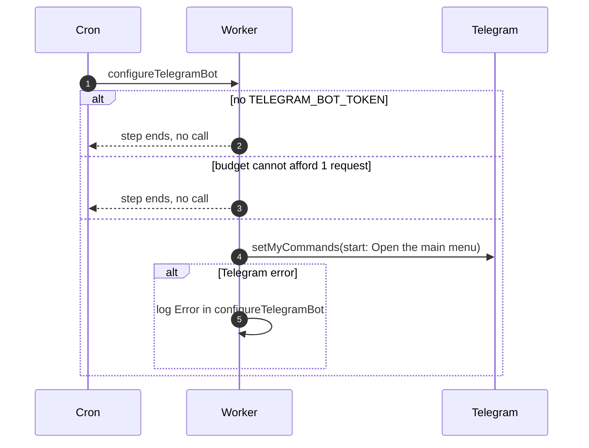

# Keeping the Telegram bot command list in sync

> **Question:** How often does the cron contact Telegram to set up
> the bot, and what does it set?
>
> **Answer:** On every 5-minute tick that has a bot token and one
> request to spare, the worker tells Telegram the bot's command
> list: a single command, "start", described as "Open the main
> menu". It does not check whether the list is already set and
> remembers nothing between ticks, so Telegram is called up to
> 288 times a day. Nothing is shown to any person.
>
> **Notes:**
> - Costs 1 request of the tick's 40.
> - Without TELEGRAM_BOT_TOKEN the step returns without a call. If
>   the tick is out of budget it is skipped until the next one.
> - The round menu button next to the message box is managed in
>   BotFather and is not touched here, since the API can only swap
>   it, never remove it.
> - If Telegram refuses, the error goes to the log line
>   "Error in configureTelegramBot".

