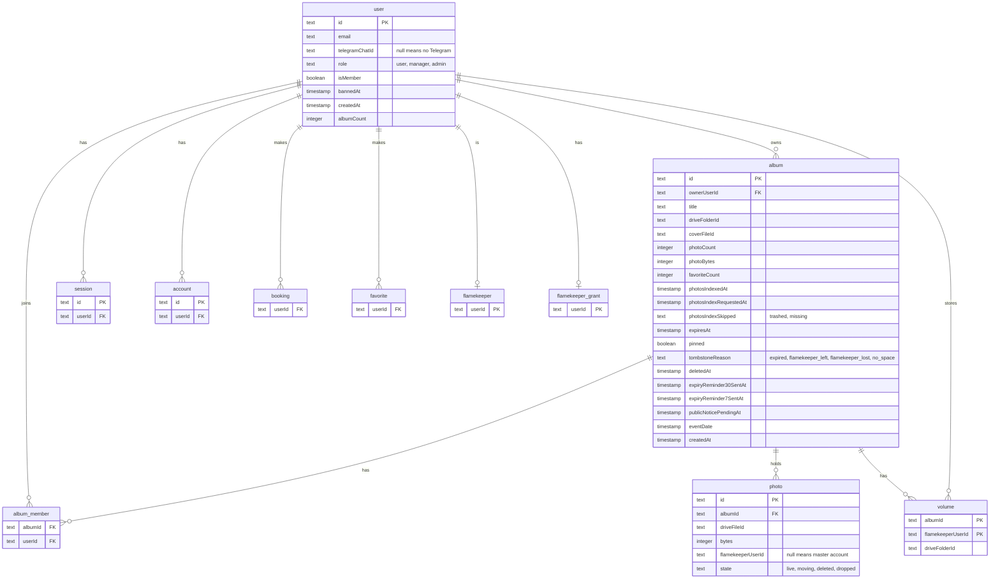

# Data used by the album and housekeeping cron steps

> **Question:** Which tables and stored values do the album expiry,
> public notice, photo backfill, bot menu and stale signup steps
> read or write?
>
> **Answer:** They work on the album, photo and volume tables, the
> owners and co-authors in user and album_member, and the sign-in
> tables when deleting stale signups. The bot menu step touches no
> table. Only listed columns are used by these steps.
>
> **Notes:**
> - KV `photo-backfill:budget` holds JSON with the UTC day and the
>   writes spent that day. It expires after 2 days.
> - KV `album:list:DRIVE_FOLDER_ID` and `album:detail:ALBUM_ID` are
>   album page caches. Expiry deletes both keys when it removes an
>   album.
> - R2 is not used by these steps.
> - Tables booking, favorite, flamekeeper and flamekeeper_grant are
>   only checked to see if a stale signup owns something, so only
>   their user link is shown.

