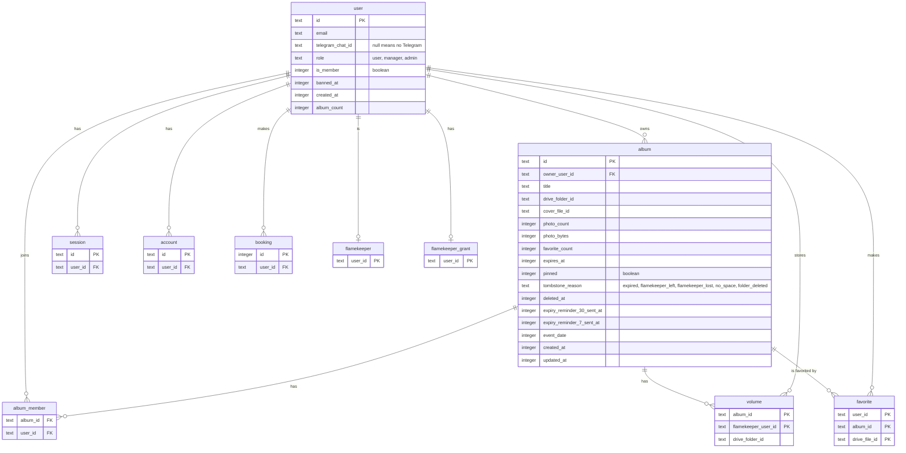

# Data used by the album and housekeeping cron steps

> **Question:** Which tables and stored values do the album expiry
> and bot menu steps read or write?
>
> **Answer:** They work on the album and volume tables, the
> owners and co-authors in user and album_member. Early expiry also reads
> favorite. Deleting an expired album reads volume,
> flamekeeper and flamekeeper_grant to find each volume's owner, and
> reads Drive listings, not a photo table, to decide what to delete. The bot menu step touches no table, only a KV marker. Only the
> columns these steps use are listed.
>
> **Notes:**
> > - KV `album:list:DRIVE_FOLDER_ID` and `album:detail:ALBUM_ID` are
>   album page caches. Expiry deletes both keys when it removes an
>   album. Their own lifetimes are set in the albums folder, not by
>   these steps.
> - R2 is not used by these steps.
> - Column names are the database names.
> - album_member also has its own id and created_at, not used here.
> 

