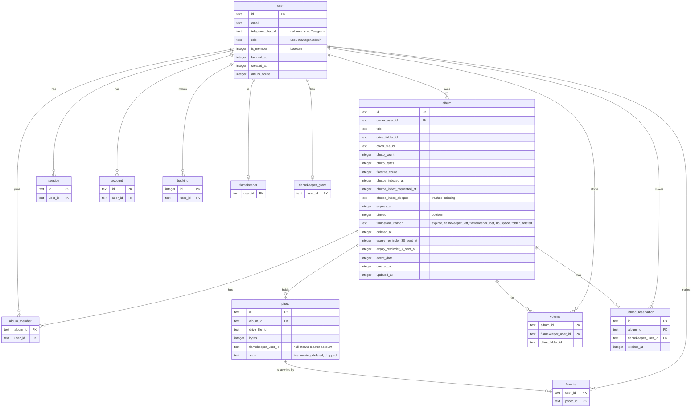

# Data used by the album and housekeeping cron steps

> **Question:** Which tables and stored values do the album expiry,
> photo backfill and bot menu steps read or write?
>
> **Answer:** They work on the album, photo and volume tables, the
> owners and co-authors in user and album_member. Early expiry also reads
> favorite. Deleting an expired album reads buffer_volume, volume,
> flamekeeper and flamekeeper_grant to find each volume's owner, and
> no longer reads photo to decide what to delete. The bot menu step touches no table, only a KV marker. Only the
> columns these steps use are listed.
>
> **Notes:**
> - KV `photo-backfill:budget` holds JSON with the UTC day and the
>   writes spent that day. It expires after 2 days.
> - KV `album:list:DRIVE_FOLDER_ID` and `album:detail:ALBUM_ID` are
>   album page caches. Expiry deletes both keys when it removes an
>   album. Their own lifetimes are set in the albums folder, not by
>   these steps.
> - R2 is not used by these steps.
> - Column names are the database names.
> - album_member also has its own id and created_at, not used here.
> - The photo state is read, not changed, by these steps.

