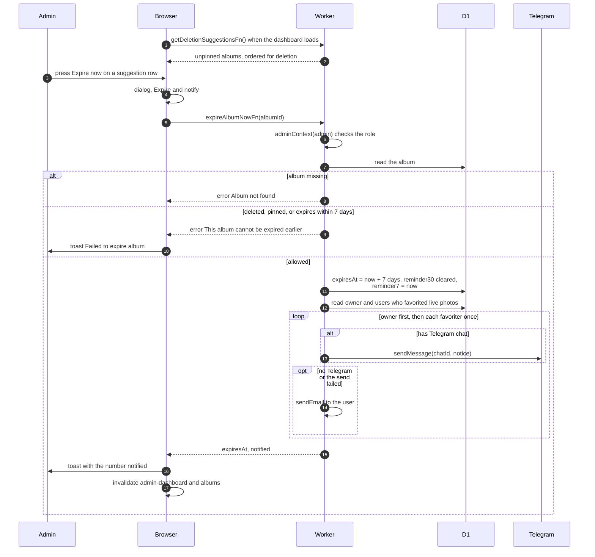

# Admin brings an album's expiry forward

> **Question:** What happens when an admin presses "Expire now" in
> the Free up space panel?
>
> **Answer:** The admin sees a dialog, "Expire "TITLE" now?", and
> confirms with "Expire and notify". The album's expiry date is set
> to 7 days from now, the 30-day reminder is cleared, and the 7-day
> reminder is marked as already sent so the cron does not repeat
> it. The owner and everyone who favorited a live photo in the
> album are told by Telegram, or by email if they have no Telegram.
> The admin sees a toast: "TITLE" will be deleted in 7 days. N
> person (or people) notified. The actual deletion is done later by
> the cron in `expiry-delete.md`.
>
> **Notes:**
> - Only admins can use it. The list is ordered with albums nobody
>   favorited first, then by soonest expiry, then by largest size.
> - Refused when the album is deleted, pinned, or already expires
>   within 7 days: "This album cannot be expired earlier". A missing
>   album gives "Album not found". The browser shows
>   "Failed to expire album" for any error.
> - Texts: owner gets Your album "TITLE" will be deleted on DATE to
>   free up storage. Favoriters get An album with photos you
>   favorited, "TITLE", will be deleted on DATE to free up storage.
>   Both add that there is no backup.
> - An email is also the fallback when a Telegram send fails.
> - Telegram sends here are not counted in the cron budget.
> - Fuller admin flow is in the admin folder.

