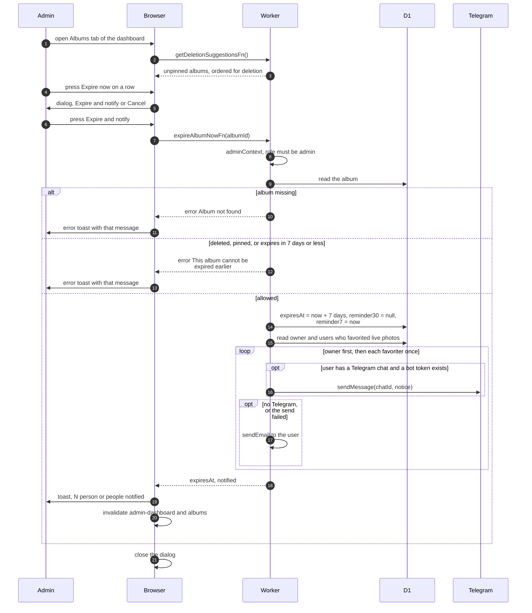

# Admin brings an album's expiry forward

> **Question:** What happens when an admin presses "Expire now" in
> the Free up space panel?
>
> **Answer:** The admin sees a dialog, Expire "TITLE" now?, and
> confirms with "Expire and notify". The album's expiry date is set
> to 7 days from now, the 30-day reminder mark is cleared, and the
> 7-day reminder is marked as already sent so the cron does not
> repeat it. The owner and everyone who favorited a live photo in
> the album are told by Telegram, or by email if they have no
> Telegram. The admin sees a toast: "TITLE" will be deleted in 7
> days. N person (or people) notified. The cron deletes the album
> later, as described in `expiry-delete.md`.
>
> **Notes:**
> - Only admins can use it. Managers cannot. The panel is loaded
>   when an admin opens the Albums tab of the dashboard. The list
>   shows unpinned albums that nobody favorited first, then favorited
>   ones, each group by soonest expiry (no expiry date last), then
>   largest size.
> - Refused when the album is deleted, pinned, or already expires
>   in 7 days or less: "This album cannot be expired earlier". A
>   missing album gives "Album not found". The toast shows the
>   server's message. "Failed to expire album" appears only for an
>   error that has no message.
> - The dialog closes after the call, whether it worked or not.
> - Owner text: Your album "TITLE" will be deleted on DATE to free
>   up storage. Favoriter text: An album with photos you favorited,
>   "TITLE", will be deleted on DATE to free up storage. Both add
>   that there is no backup, and a link to the album if the site
>   address is configured.
> - A person is counted as notified only if the Telegram message or
>   the email went out. The email subject is Album "TITLE" will be
>   deleted on DATE. Email is also used when a Telegram send fails
>   or there is no bot token.
> - These sends happen in the web request, so they do not use the
>   cron's 40-request counter.
> - The fuller admin flow is in `../../admin/expire-album-early.md`.

