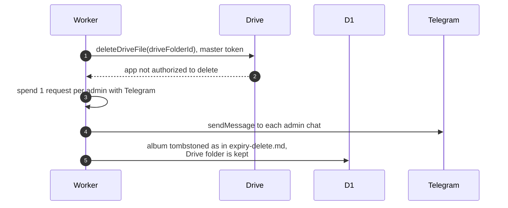

# When Drive refuses to delete an album folder

> **Question:** What happens if the master account cannot delete an
> expired album's Drive folder because other accounts' files are in it?
>
> **Answer:** By then the volumes have been emptied with their own
> owner tokens (see `expiry-delete.md`), so a refusal means files the
> app could not see or reach, such as an unreachable flamekeeper's
> files. The album is still deleted from the app, the Drive folder is
> kept, and every admin with Telegram gets an alert saying the folder
> could not be removed and may need manual cleanup. There is no second
> try at the folder delete.
>
> **Notes:**
> - The alert costs 1 request per admin with Telegram. If the tick
>   cannot afford it, the album waits for a later tick so the alert is
>   not lost. If no admin has Telegram, only a log line is written and
>   the album is deleted. Without a bot token the alert is skipped the
>   same way.
> - Alert text: "#savenuimg: album ID was deleted but its Drive folder
>   could not be removed, so it may still hold public files that need
>   manual cleanup." ID is the album's ID.

