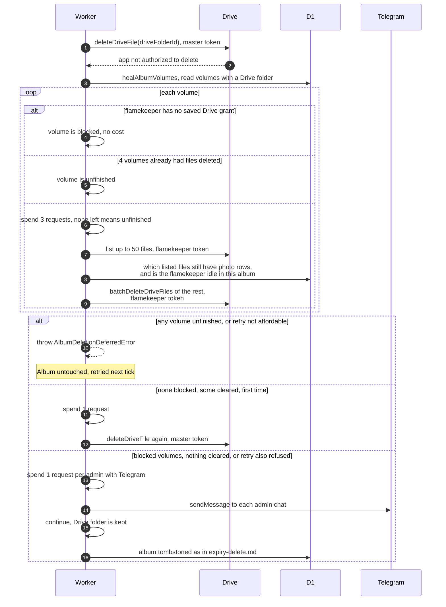

# When Drive refuses to delete an album folder

> **Question:** What happens if the master account cannot delete an
> expired album's Drive folder because flamekeeper files are in it?
>
> **Answer:** The cron tries to empty the album's volume subfolders
> using each flamekeeper's own token. If at least one was emptied
> and none is blocked, it tries the folder delete once more. If
> some volumes could not be finished in this tick, the album is left
> whole and tried again on a later tick. If some subfolders cannot
> be emptied, or the second try is refused too, the album is still
> deleted from the app, the Drive folder is kept, and every admin
> with Telegram gets an alert saying files need manual cleanup.
>
> **Notes:**
> - A volume is one flamekeeper's subfolder in one album.
> - Only subfolders where files were actually deleted count toward
>   a limit of 4 per attempt. Volumes after that count as
>   unfinished. A volume costs 3 requests to start, unless its
>   flamekeeper has no saved Drive grant, which costs nothing and
>   counts as blocked. At most 50 leftover files are listed and
>   deleted per volume. A volume with 50 or more files listed is
>   unfinished, because more may remain.
> - Files that still have a photo row (any state except deleted)
>   are never deleted by this. A volume is only emptied if its
>   flamekeeper has no such photo rows in the album and no
>   unexpired upload reservation. Otherwise it counts as blocked.
>   Any Drive error while emptying also counts as blocked.
> - If nothing was cleared and nothing is blocked (for example the
>   album has no volumes), the folder is not retried and the
>   album goes straight to the alert.
> - The retry costs 1 request. The alert costs 1 request per admin
>   with Telegram. If the tick cannot afford either, the album
>   waits for a later tick so the alert is not lost. If no admin has
>   Telegram, only a log line is written and the album is deleted.
>   Without a bot token the alert is skipped the same way.
> - Alert text for blocked volumes: "#savenuimg: album ID was
>   deleted but N of its volume subfolders could not be emptied, so
>   its Drive folder may still hold public files that need manual
>   cleanup." ID is the album's ID. When the count is 0 it says
>   instead that the Drive folder could not be removed.

