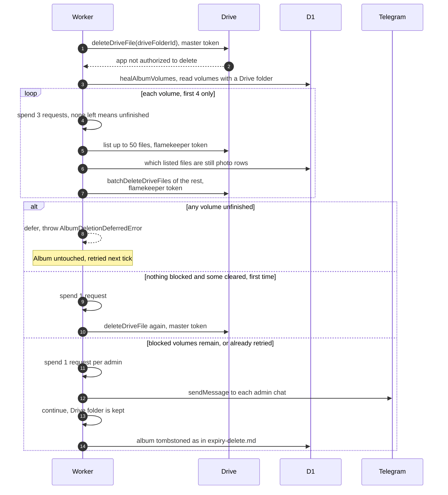

# When Drive refuses to delete an album folder

> **Question:** What happens if the master account cannot delete an
> expired album's Drive folder because flamekeeper files are in it?
>
> **Answer:** The cron tries to empty the album's volume subfolders
> using each flamekeeper's own token, then tries the folder delete
> once more. If the subfolders are all clear, the album is deleted.
> If too much remains for this tick or the budget runs out, the
> album is left whole and tried again on a later tick. If some
> subfolders cannot be emptied, the album is still deleted from the
> app, the Drive folder is kept, and every admin with Telegram gets
> an alert saying files need manual cleanup.
>
> **Notes:**
> - A volume is one flamekeeper's subfolder in one album.
> - At most 4 volumes are worked on per attempt, and the rest count
>   as unfinished. Each volume costs 3 requests to start. At most
>   50 leftover files are listed and deleted per volume.
> - Files still listed in the photo table are never deleted by
>   this. A volume is only emptied if the flamekeeper has no live
>   photos in the album and no unexpired upload reservation.
> - A volume whose flamekeeper has no Drive grant counts as
>   blocked.
> - The alert costs 1 request per admin. If the tick cannot afford
>   it, the album waits for a later tick so the alert is not lost.
>   If there are no admins, only a log line is written.
> - Alert text for blocked volumes: "#savenuimg: album ID was
>   deleted but N of its volume subfolders could not be emptied, so
>   its Drive folder may still hold public files that need manual
>   cleanup." With no counted volumes the text says the Drive folder
>   could not be removed.

