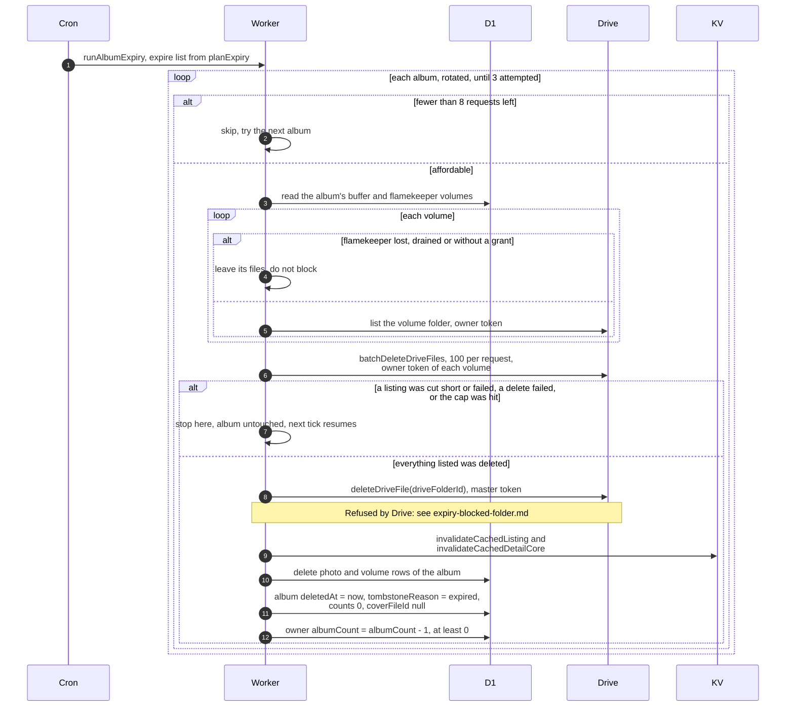

# Deleting an expired album

> **Question:** What exactly is deleted when an album expires, and
> whose Google account does the deleting?
>
> **Answer:** Each hourly run the cron works on at most 3 expired
> albums. For each one it lists every volume fresh from Drive, using
> that volume's own owner token (buffer, or the flamekeeper who holds
> it), and deletes what it finds, 100 files per request. It never
> trusts the cached listing for this and stores no progress. When
> every listing was complete and every delete worked, the master
> deletes the album's Drive folder, the cached listing and detail
> page are cleared, the volume rows are removed, and the album row
> stays as a tombstone with reason "expired", so its link shows
> "This album has expired". The owner's album count goes down by one.
> Anything else (a failed or cut-short listing, a failed token, a
> failed delete, too many files for the budget) leaves the album as
> it is and the next tick tries again.
>
> **Notes:**
> - Resuming needs nothing stored. The album is still not tombstoned,
>   so the next tick lists again and finds only what is left. Files
>   already deleted are gone from the listing, so nothing is deleted
>   twice, and a delete of a file that is already gone counts as done.
> - A complete pass that deletes everything it listed is finished in
>   the same tick, without a second listing. A pass that hit the
>   budget cap or a cut-short listing is not.
> - An unreachable flamekeeper (lost, drained, or no saved grant) is
>   the one case that does not block. Their files are left in place,
>   since the app has no access to delete them, and the album is
>   still tombstoned. A flamekeeper whose token merely fails this
>   tick (not yet marked lost) is retried.
> - Master-owned files are not listed. They go when the master
>   deletes the album folder.
> - Each album needs at least 8 requests left in the tick, plus 1 for
>   the master token on the first album. Listing pages and delete
>   batches (1 plus 1 per 100 files) come out of the same budget, and
>   deletes are capped to what is left. The list is rotated by the
>   current hour, and the limit of 3 counts every album attempted.
> - Deleted flamekeeper bytes are released from their usage as each
>   batch succeeds.
> - A Drive folder already gone (not found) counts as deleted. Any
>   other Drive error except "refused" leaves the album as it is.
> - A folder refused by Drive is in `expiry-blocked-folder.md`.
> - Manual album deletion by an owner or admin uses the same pass.
> - The master token is the club account's saved refresh token. It
>   is kept in memory for about 50 minutes. Only `drive.file` tokens
>   are used; the buffer's full-scope token is never involved.

