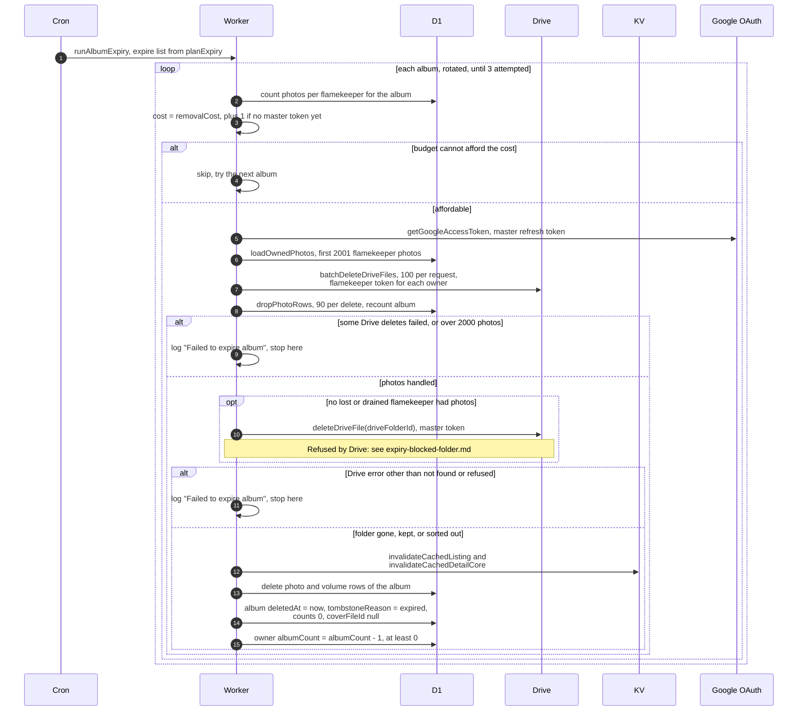

# Deleting an expired album

> **Question:** What exactly is deleted when an album expires, and
> whose Google account does the deleting?
>
> **Answer:** Each tick the cron deletes at most 3 expired albums.
> Photos stored in a flamekeeper's Drive are deleted first, using
> that flamekeeper's own token, in batches of 100 files per request.
> Then the album's Drive folder in the club master account is
> deleted using the master token. Then the cached listing and detail
> page are cleared, the photo and volume rows are removed, and the
> album row stays as a tombstone with reason "expired", so its link
> shows "This album has expired". The owner's album count goes down
> by one. If a Drive delete fails, the album row stays and the next
> tick tries again. Photos already deleted stay deleted.
>
> **Notes:**
> - Cost of one album is 1, plus for each flamekeeper holding its
>   photos 1 plus 1 per 100 photos (rounded up), plus 1 for the
>   master token on the first album of the tick. If the tick cannot
>   afford an album it is skipped and the next one is tried.
> - The list is rotated by the current 5-minute slot, so the same
>   album is not always first. The limit of 3 counts every album
>   attempted, including ones that then fail or are put off.
> - At most 2000 flamekeeper photos are removed per attempt. A
>   larger album fails with "This album is too large to delete in
>   one go. Some photos were deleted; try again to continue." and
>   continues on the next tick.
> - Photos with no flamekeeper are not deleted one by one. They go
>   when the master deletes the folder.
> - If a flamekeeper is lost or drained, their photo rows are
>   dropped without touching Drive and the Drive folder is kept.
>   The album is still tombstoned and no admin is alerted.
> - A Drive folder already gone (not found) counts as deleted. Any
>   other Drive error except "refused" leaves the album as it is.
> - A folder refused by Drive is in `expiry-blocked-folder.md`.
> - The master token is the club account's saved refresh token. It
>   is kept in memory for about 50 minutes.

