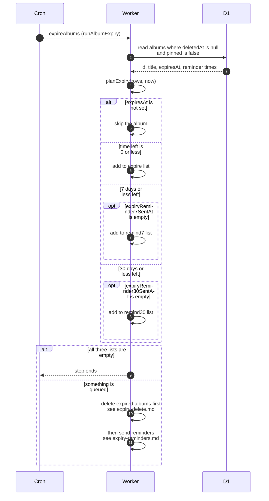

# Which albums expire or get a reminder

> **Question:** How does the cron decide which albums to delete and
> which owners to warn?
>
> **Answer:** Every tick the expireAlbums step reads all albums that
> are not deleted and not pinned. An album whose expiry date has
> passed is queued for deletion. An album with 7 days or less left
> is queued for the 7-day reminder if that reminder was never sent.
> An album with more than 7 and at most 30 days left is queued for
> the 30-day reminder if that was never sent. Albums with no expiry
> date or that are pinned are never touched. Deletion runs first,
> then the reminders.
>
> **Notes:**
> - A new album's expiry date is the event date plus 2 years.
>   Changing the event date of an unpinned album sets a new expiry
>   date and clears both reminder marks, see
>   `../../albums/edit-album-and-pin.md`.
> - An album that is pinned when its date passes is not deleted.
>   Once it is unpinned it is picked up on the next tick.
> - An album that first shows up with 5 days left only gets the
>   7-day reminder. It never gets the 30-day one.
> - If nothing is queued, the step ends without any outside call.
> - Deletion is in `expiry-delete.md`, reminders in
>   `expiry-reminders.md`, and an admin bringing the date forward
>   in `expire-early.md`.

