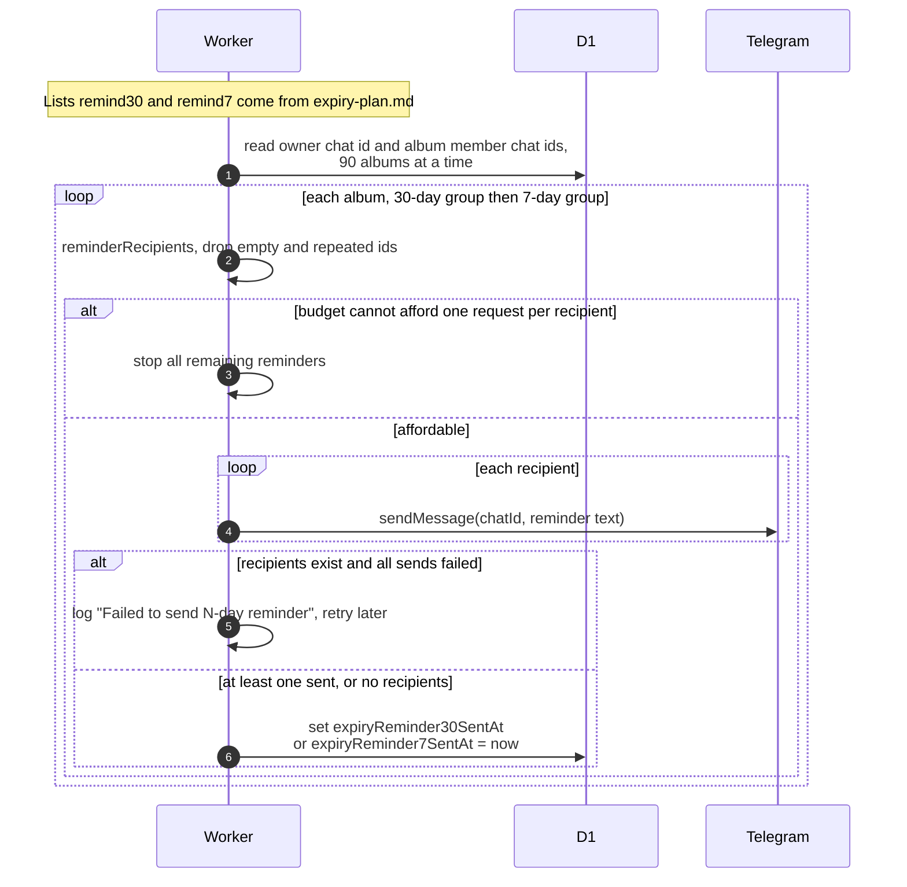

# Expiry reminders to owners and co-authors

> **Question:** Who is warned before an album is deleted, when, and
> how?
>
> **Answer:** An album with 30 days or less left, and one with 7
> days or less left, each trigger one Telegram message, once per
> album. It goes to the owner and every co-author who has linked
> Telegram. The text is: Your album "TITLE" will be deleted in 30
> days (or 7 days), on DATE. There is no backup, so download the
> photos you want to keep. A link to the album follows. The
> reminder time is saved only after at least one send worked.
>
> **Notes:**
> - Each message costs 1 request. If the tick cannot afford an
>   album's messages, all remaining reminders wait for the next
>   tick. The 30-day group is handled before the 7-day group.
> - If every send for an album fails, nothing is saved and the next
>   tick retries it.
> - If the album has no recipient with Telegram, the reminder is
>   saved as sent anyway, so nobody is ever told.
> - Without a bot token the step logs "TELEGRAM_BOT_TOKEN not
>   configured, skipping expiry reminders".
> - Dates are shown in the club time zone. The link is added only
>   if the site address is configured.
> - Members who only favorited photos are not sent these. An early
>   expiry by an admin is in `expire-early.md`.

