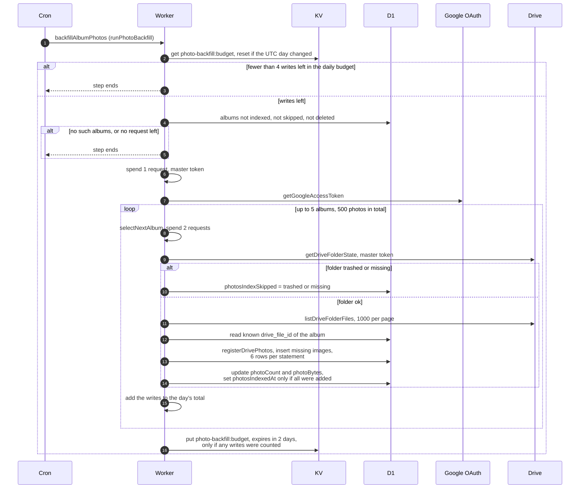

# Filling the photo table for older albums

> **Question:** How does the cron copy an old album's photo list
> from Drive into the database without using too many database
> writes?
>
> **Answer:** Each tick the backfillAlbumPhotos step picks up to 5
> albums that have never been indexed and reads their Drive
> folders with the master token. For each album it adds rows for
> photos not yet in the table. A shared daily budget of database
> writes limits the total, 60,000 per UTC day unless set otherwise.
> When the day's budget is used up the step does nothing until
> midnight UTC. An album is marked indexed only when all its
> missing photos were added, otherwise it is picked again later.
>
> **Notes:**
> - Daily budget setting is PHOTO_BACKFILL_DAILY_WRITE_BUDGET. A
>   missing, negative or non-numeric value means 60,000. The spent
>   count is kept in KV under `photo-backfill:budget` with the UTC
>   day, expires after 2 days, and is saved only if something was
>   spent.
> - A photo costs 3 writes and each album that gets photos costs 1
>   more. An album with no new photos, a trashed folder or a missing
>   folder costs 1. One run adds at most 500 photos. 1 write of the
>   day's budget is always kept in reserve, so the step stops when
>   fewer than 4 writes are left.
> - Album pages no longer read the table or ask for indexing, so
>   only requests made before #18 still go first, oldest first. The
>   rest go newest event first (creation date if there is no event
>   date). Deleted albums and skipped ones are never chosen. The
>   table still serves favorites and expiry until #25.
> - Photo rows get no flamekeeper, and are inserted 6 rows at a
>   time. Only files whose type starts with image/ are added.
> - Outside requests: 1 for the master token, then 2 per album
>   (folder check and first page of files), plus 1 for every extra
>   page of 1000 files. The step stops when it cannot afford the
>   next album.
> - Other Drive errors are logged. No daily writes are counted and
>   the album is not tried again in the same tick, only on a later
>   one. A folder that disappears while its files are being listed
>   is marked missing.
> - Only the master token is used. Nothing is deleted from Drive.

