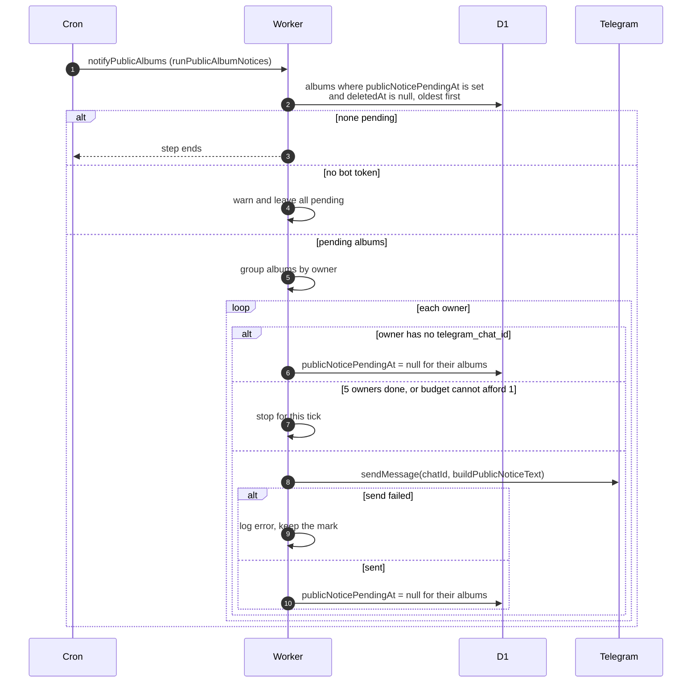

# One-time notice that albums are now public

> **Question:** How do owners of existing albums get told their
> albums became public?
>
> **Answer:** Migration 0026 marked every album that was not
> deleted and was not already shared with a pending-notice time.
> Each tick the notifyPublicAlbums step finds albums with that mark,
> groups them by owner, and sends each owner one Telegram message
> listing their albums. After the message is sent, or when the owner
> has no Telegram, the mark is cleared. A failed send keeps the mark
> so the next tick retries.
>
> **Notes:**
> - One album: Your album "TITLE" is now public and listed in the
>   gallery. Anyone with the link could already open its Drive
>   folder, so nothing else changes. A link to the album follows
>   if the site address is configured.
> - Several albums: N of your albums are now public and listed in
>   the gallery, then up to 10 titles, "and N more" if over 10,
>   then the same Drive sentence in plural, then a link to the
>   albums gallery page.
> - At most 5 owners are messaged per tick, 1 request each, and a
>   failed send counts too. Owners are taken oldest mark first.
>   Owners with no Telegram cost nothing and do not count toward
>   the 5, but one listed after the cut-off waits for the next
>   tick like everyone else.
> - Without a bot token nothing is cleared and the step logs
>   "TELEGRAM_BOT_TOKEN not configured, leaving public album
>   notices pending".
> - The migration also removed the old is_shared column.
> - After every pending album is cleared, the step does nothing.
>   Deleted albums are never messaged about.

