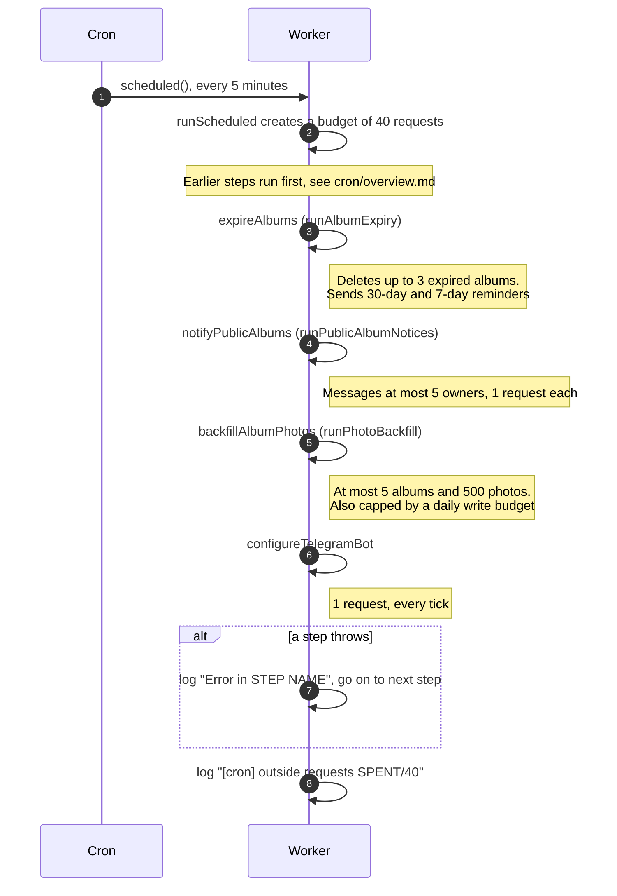

# How the four housekeeping steps run

> **Question:** When do the album expiry, public notice, photo
> backfill and bot menu steps run, and how much can they do each
> time?
>
> **Answer:** All four run on every 5-minute cron tick, one after
> the other, after the booking and flamekeeper steps. They share one
> counter of 40 outside requests for the whole tick. A step that
> cannot afford its next request stops or skips that item and tries
> again on a later tick. If a step crashes, the error is logged and
> the next step still runs.
>
> **Notes:**
> - Cloudflare allows 50 outside requests per run. The counter is
>   set to 40. The code does not say why 40, and I could not
>   confirm from it which calls Cloudflare itself counts.
> - The steps before these four are in `../overview.md`. They use
>   the same counter, so what is left for the four depends on them.
> - The counter does not include D1, KV or R2 calls. It does
>   include Telegram sends, Google token refreshes and Drive calls
>   made by the cron. Messages sent from the website, such as the
>   early expiry notice, are not part of it.
> - Each step is in its own file here: expiry in
>   `expiry-plan.md`, public notice in `public-notice.md`, backfill
>   in `photo-backfill.md`, bot menu in `bot-menu.md`.

