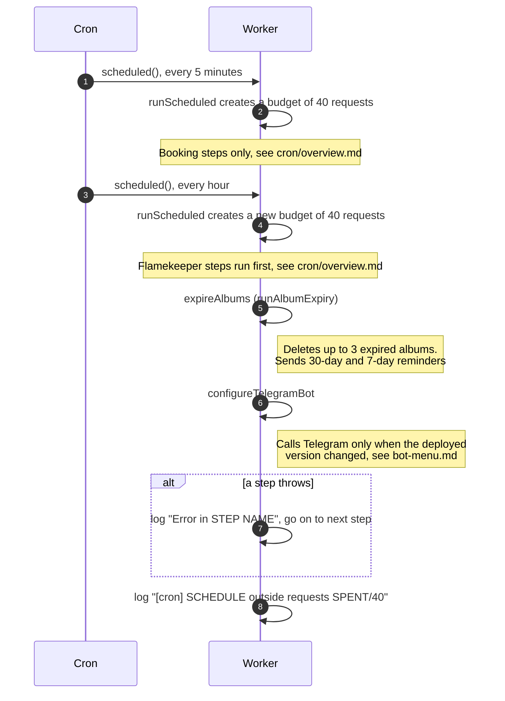

# How the housekeeping steps run

> **Question:** When do the album expiry and bot menu
> steps run, and how much can they do each time?
>
> **Answer:** Album expiry runs on the hourly trigger, as the last
> step after the flamekeeper steps, and shares that run's budget of
> 40 outside requests with them. The bot menu check runs right after
> it, on the same trigger, and calls Telegram only once per deploy.
> A step that cannot afford its
> next request stops or skips that item and tries again on a later
> run. If a step crashes, the error is logged and the next step
> still runs.
>
> **Notes:**
> - Cloudflare allows 50 outside requests per run. The counter is
>   set to 40. The code does not say why 40, and I could not
>   confirm from it which calls Cloudflare itself counts.
> - The steps before these are in `../overview.md`. They use the
>   same counter within one trigger, so what is left depends on
>   them. The 5-minute, hourly and daily triggers never share a
>   counter.
> - The counter does not include D1, KV or R2 calls. It does
>   include Telegram sends, Google token refreshes and Drive calls
>   made by the cron. Messages sent from the website, such as the
>   early expiry notice, are not part of it.
> - Each step is in its own file here: expiry in
>   `expiry-plan.md`, bot menu in `bot-menu.md`.

