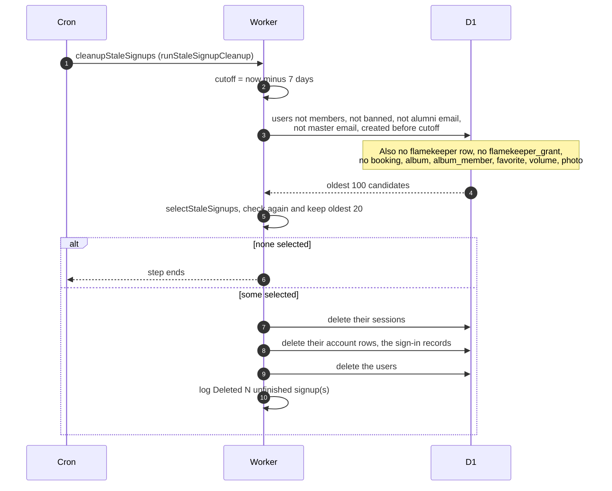

# Removing unfinished signups

> **Question:** Which accounts does the cron delete as unfinished
> signups, and which can it never delete?
>
> **Answer:** Each tick it deletes up to 20 accounts that were
> created at least 7 days ago and never became club members. The
> oldest go first. Their sessions and sign-in records go with
> them. It never deletes a member, a banned account, an account
> with an alumni address ending in @alumni.nu.edu.kz, the club
> master Google account, any flamekeeper or anyone with a saved
> Drive grant, or anyone who has a booking, owns or co-edits an
> album, has a favorite, or holds a flamekeeper volume or photo.
>
> **Notes:**
> - No outside requests are used, so the 40-request counter is not
>   touched.
> - The database looks at the 100 oldest matching accounts, and the
>   code then picks the oldest 20 of those. Each tick the rest wait.
> - The master account is skipped only when GOOGLE_MASTER_EMAIL is
>   set. The comparison ignores case and spaces.
> - The user's role is not checked. An admin or manager account
>   that is not marked as a member, has no activity and is over 7
>   days old would be deleted like any other.
> - Deleting the user also removes rows that cascade from it, such
>   as Telegram link tokens.
> - Nothing is sent to the person. The only trace is the log line
>   "Deleted N unfinished signup(s)".
> - The same rules are applied twice, in the database query and
>   again in code, so a mistake in one does not delete a member.

