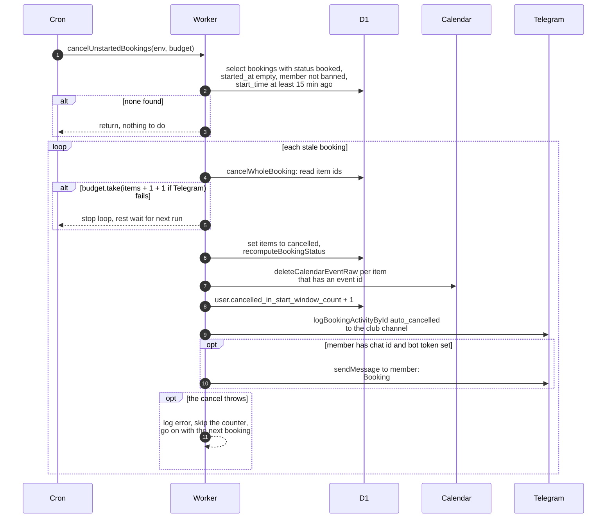

# Auto-cancelling bookings nobody picked up

> **Question:** When is a booking cancelled automatically because the member never started it?
>
> **Answer:** Every 5 minutes, any booking still `booked` that the member never started, and whose start time was at least 15 minutes ago, is cancelled. Its items become `cancelled`, the booking status is recalculated, and each item's calendar event is deleted. The member's `cancelled_in_start_window_count` goes up by 1. The club channel gets an "Auto-cancelled (no pickup)" log, and the member gets a Telegram message. Bookings of banned members are skipped. If the budget runs out, the step stops and the remaining bookings wait for the next run.
>
> **Notes:**
> - The budget cost per booking is its number of items (counted even if an item has no calendar event), plus 1 for the channel log, plus 1 if the Worker has a bot token and the member has a Telegram chat. The cost is taken before anything changes, so a booking is never half-cancelled for budget reasons. The cost is not refunded if the cancel then fails.
> - The 15 minutes is `START_WINDOW_GRACE_MS`. The start warning reminder tells the member the booking will be cancelled in 15 minutes (see `reminders.md`).
> - The counter goes up once per booking, not per item, and only after the cancel itself went through. If the cancel throws, nothing is counted, the error is logged, the loop moves on to the next booking, and the booking is picked up again next run.
> - A booking with no items left to cancel (all already `returned` or `cancelled`, or no items at all) still has its counter raised and still gets the log and the message.
> - A failure to write the channel log, delete a calendar event or send the Telegram message is only logged to the console and does not undo the cancel. The channel log is skipped when the bot token or the club channel id is not set, but its budget cost is taken anyway.
> - The member's message says the equipment was not picked up within 15 minutes of the start time and shows that start time (club timezone, 24-hour clock). It ends by asking the member to make a new booking if the cancel was not intended.
> - Items already `returned` or `cancelled` are left alone by the cancel.
> - Next step in the run: `mark-overdue.md`. Whole run: `../overview.md`.

