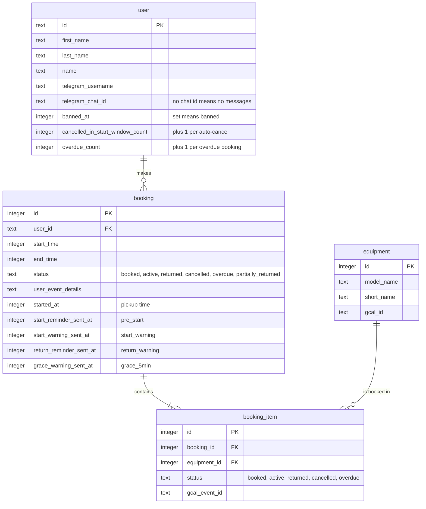

# Booking cron data

> **Question:** Which tables do the booking cron steps read and write?
>
> **Answer:** They read and write bookings and booking items, read equipment (names and calendar ids) and read users (Telegram chat, ban status). They write the four reminder timestamps on the booking and two violation counters on the user.
>
> **Notes:**
> - No KV or R2 data is used by these steps.
> - Calendar events are not stored as rows. Each booking item keeps its event id in `gcal_event_id` and each equipment row keeps its calendar id in `gcal_id`.

