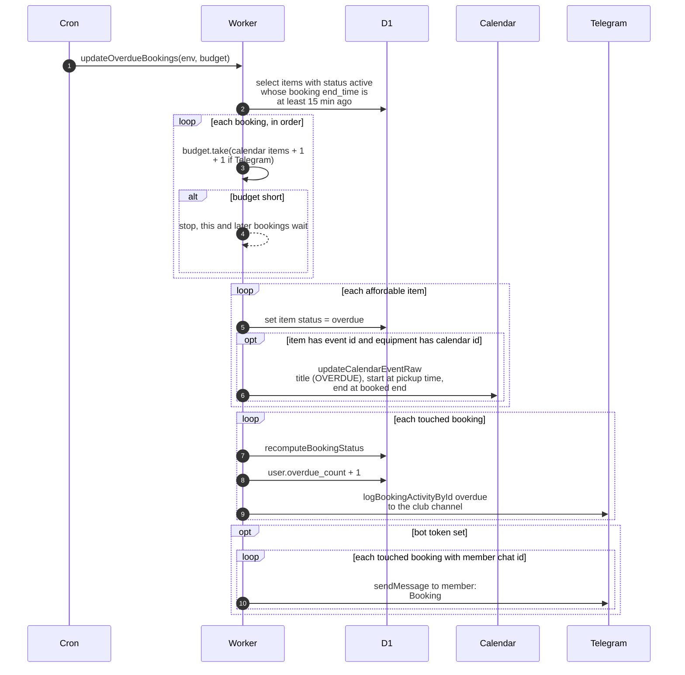

# Marking late returns as overdue

> **Question:** When does equipment become overdue, and what changes?
>
> **Answer:** Every 5 minutes, each item that is still `active` and whose booking ended at least 15 minutes ago becomes `overdue`. Its calendar event title changes to "<equipment> (OVERDUE)" and the status in its description is updated. The event is not deleted. The booking status is recalculated (it becomes `overdue`), the member's `overdue_count` goes up by 1 per booking, the club channel gets an "Overdue" log, and the member gets a Telegram message. If the budget cannot cover a booking, that booking and all later ones wait for the next run.
>
> **Notes:**
> - The 15 minutes is the grace period after the booking's end time (`START_WINDOW_GRACE_MS`). The grace reminders in `reminders.md` go out inside this window.
> - Only `active` items are picked. A booking that was never started is cancelled by `cancel-unstarted.md` instead.
> - The cost is taken per booking up front: 1 per item that has both a calendar event id and an equipment calendar id, plus 1 for the channel log, plus 1 if the member has a chat id and the bot token is set. Bookings are taken in the order the database returns them, which the code does not sort.
> - The booking counts as touched, and so gets its status recalculated, its counter raised, a channel log and a message, as soon as one of its items was set to `overdue`. This happens before the calendar call.
> - If the database update of an item fails, the item stays `active`, so the next run picks it up again. It is not counted until then. The budget already taken is not refunded.
> - If the calendar update fails after the item became `overdue`, the item is not retried, because the next run only looks for `active` items. The calendar event keeps its old title, and the booking is still counted and the member still told.
> - A booking whose items fail on one run and succeed on a later run is counted once per run in which at least one item succeeds, so its counter can go up more than once.
> - The calendar event is rewritten to start at `started_at` (or at the booked start if empty) and to end at the booked end time.
> - A failed calendar update, log or Telegram message is only logged to the console. The channel log is skipped when the bot token or the club channel id is not set, but its budget cost is taken anyway.
> - Previous step: `cancel-unstarted.md`. Next: `reminders.md`.

