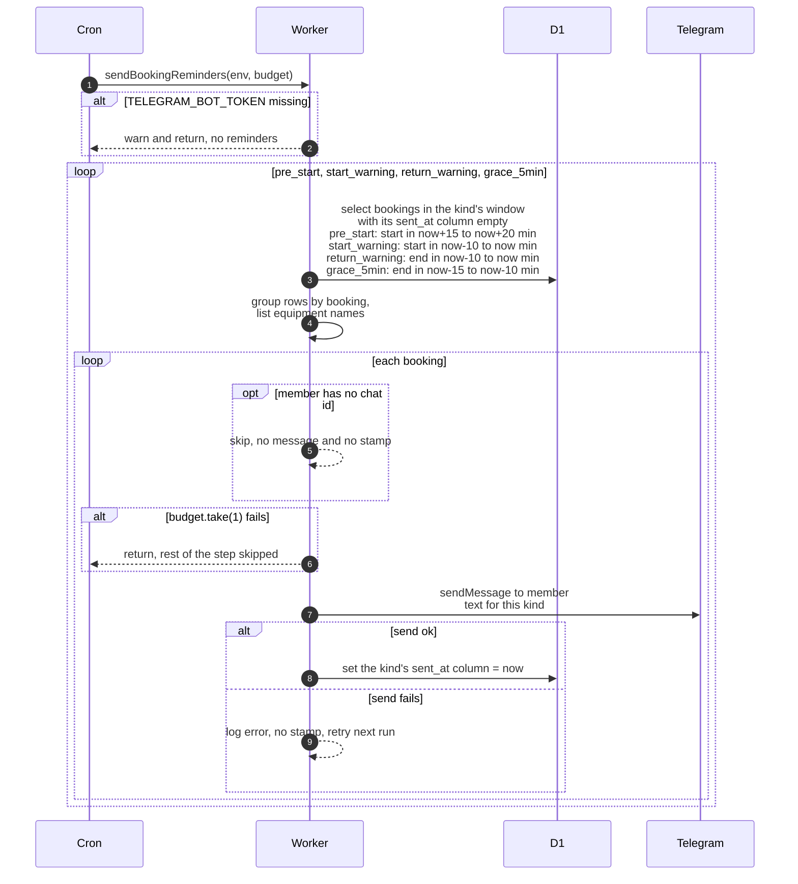

# The four booking reminders

> **Question:** Which Telegram reminders does a member get around a booking, and when?
>
> **Answer:** Every 5 minutes the Worker looks for four kinds of reminder and sends each at most once per booking. The pre-start reminder goes out when the start is 15 to 20 minutes away. The start warning goes out when the start was in the last 10 minutes. The return warning goes out when the end was in the last 10 minutes. The 5-minute grace warning goes out when the end was 10 to 15 minutes ago. After each message is sent, the matching timestamp on the booking is set so it is not sent again. Members without a Telegram chat are skipped.
>
> **Notes:**
> - Timestamp columns on `booking`: pre_start sets `start_reminder_sent_at`, start_warning sets `start_warning_sent_at`, return_warning sets `return_reminder_sent_at`, grace_5min sets `grace_warning_sent_at`.
> - Pre-start and start warning only apply to bookings with status `booked`. Return and grace warnings look at items instead: a booking qualifies if it has at least one item not `returned` or `cancelled`, whatever the booking status. Only those items are listed in the message.
> - The pre-start and grace windows are 5 minutes wide and the start and return windows are 10 minutes wide, with both edges included. A booking matches in one or two runs, and the timestamp stops repeats.
> - The message is sent first and the timestamp set second. If the send fails, nothing is stamped and the next run tries again while the window still matches. The budget for the failed send is not refunded. If the stamp fails after a send, the member could get the message again.
> - Members with no chat id are never stamped, so they are picked again each run until the window passes, at no budget cost.
> - Each message costs 1 budget. When the budget is empty the whole step returns, so kinds not yet processed are skipped this run. An error while reading one kind is logged and the next kind still runs.
> - Without `TELEGRAM_BOT_TOKEN` the step logs a warning and sends nothing.
> - Pre-start and start warning messages show the booked start and end times in the club timezone (Asia/Almaty), 24-hour clock. The return and grace messages show no times. A booking with several items gets one message listing "N items: names", using each item's short name, or its model name when there is none.
> - The start warning says the booking will be cancelled automatically in 15 minutes. The cancel actually happens 15 minutes after the booked start (`cancel-unstarted.md`), and the warning goes out up to 10 minutes after the start, so the real time left can be as little as 5 minutes.
> - The return warning and grace warning lead into `mark-overdue.md`. The grace message says 5 minutes are left, and it goes out 10 to 15 minutes after the end.

