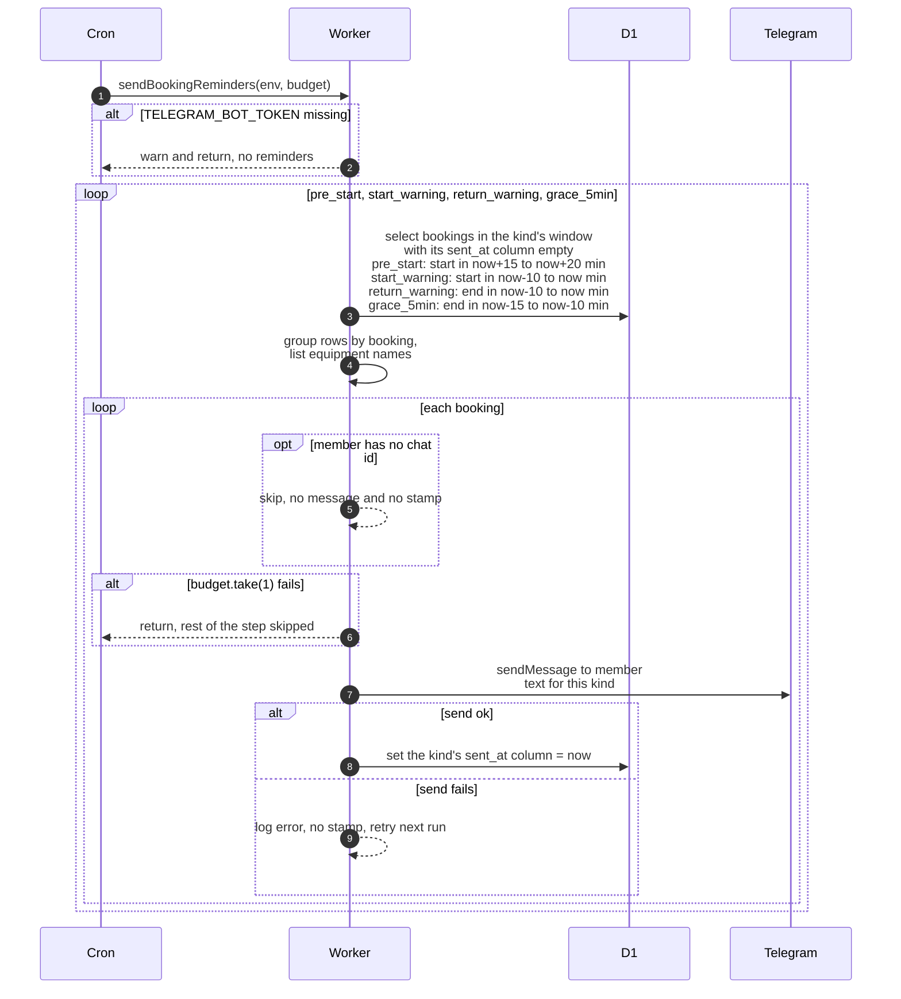

# The four booking reminders

> **Question:** Which Telegram reminders does a member get around a booking, and when?
>
> **Answer:** Every 5 minutes the Worker looks for four kinds of reminder and sends each at most once per booking. Pre-start goes out when the start is 15 to 20 minutes away. Start warning goes out when the start was in the last 10 minutes. Return warning goes out when the end was in the last 10 minutes. Five-minute grace warning goes out when the end was 10 to 15 minutes ago. After each message is sent, the matching timestamp on the booking is set so it is not sent again. Members without a Telegram chat are skipped.
>
> **Notes:**
> - Timestamp columns on `booking`: pre_start sets `start_reminder_sent_at`, start_warning sets `start_warning_sent_at`, return_warning sets `return_reminder_sent_at`, grace_5min sets `grace_warning_sent_at`.
> - Pre-start and start warning only apply to bookings with status `booked`. Return and grace warnings apply to any booking that has at least one item not `returned` or `cancelled`, whatever the booking status.
> - Each window is 5 to 10 minutes wide, so a booking normally matches in one or two runs, and the timestamp stops repeats.
> - The message is sent first and the timestamp set second. If the send fails, nothing is stamped and the next run tries again while the window still matches. If the stamp fails after a send, the member could get the message again.
> - Members with no chat id are never stamped, so they are re-selected each run until the window passes, at no budget cost.
> - Each message costs 1 budget. When the budget is empty the whole step returns, so kinds not yet processed are skipped this run.
> - Without `TELEGRAM_BOT_TOKEN` the step logs a warning and sends nothing.
> - Times in the messages are shown in the club timezone (Asia/Almaty), 24-hour format. A booking with several items gets one message listing "N items: names".
> - The start warning promises cancellation in 15 minutes, which is what `cancel-unstarted.md` does. The return warning and grace warning lead into `mark-overdue.md`.

