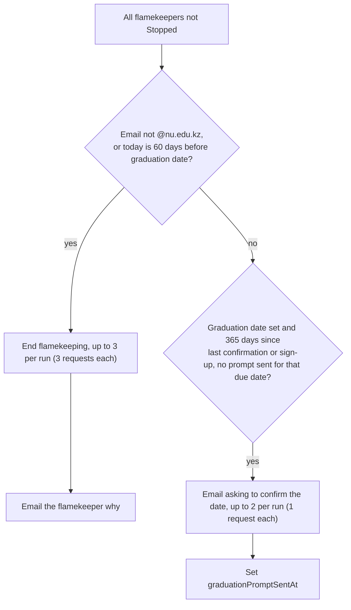

# Daily

Schedule `0 3 * * *` (03:00 UTC). One step, `graduateFlamekeepers`, in `src/lib/pool/graduation-server.ts`. Budget rules: [overview.md](overview.md).

When does flamekeeping end automatically, and who gets asked to confirm?

- Ending follows `endFlamekeeping`: Draining while volumes are held, otherwise Stopped (see [hourly.md](hourly.md)).
- Reason is `domain` (left the NU domain) or `graduation`. Lost flamekeepers are skipped for the confirmation prompt.
- A flamekeeper stopped in this run gets no prompt.
- Prompt timing: the confirmation clock restarts when the flamekeeper confirms (`graduationConfirmedAt`).
