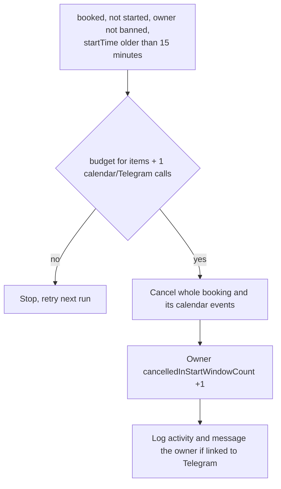
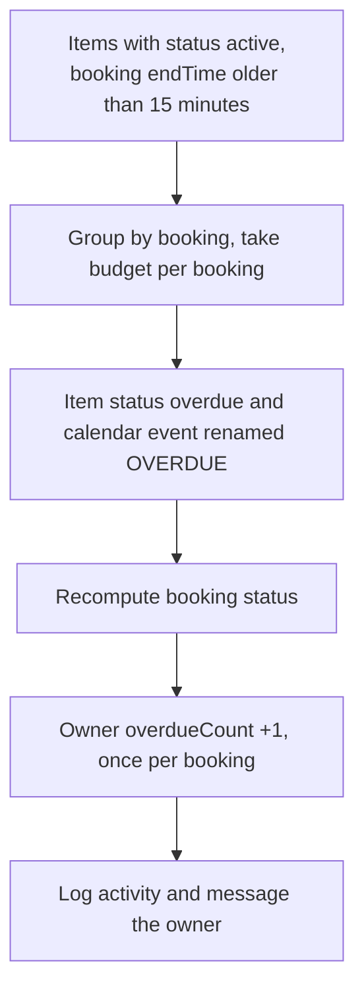
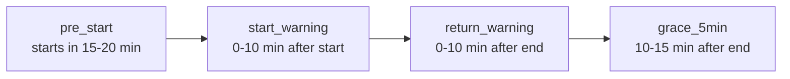

# Every 5 minutes: bookings

Schedule `*/5 * * * *`. Code: `src/lib/booking/cron.ts`. Budget rules: [overview.md](overview.md).

What happens to a booking that is never picked up?

What happens to equipment that is still out after the end time?

When are reminders sent?

- Each reminder sets its own `*_sent_at` column on `booking` (`start_reminder_sent_at`, `start_warning_sent_at`, `return_reminder_sent_at`, `grace_warning_sent_at`), so it is sent once. Costs one request per booking; the step returns when the budget is gone.
- The two start reminders need status `booked`. The two return reminders need at least one item not returned or cancelled.
- Users without a Telegram chat are skipped. Without `TELEGRAM_BOT_TOKEN` the whole reminder step is skipped, auto-cancel and overdue still run.
- The 15-minute grace is `START_WINDOW_GRACE_MS`.
