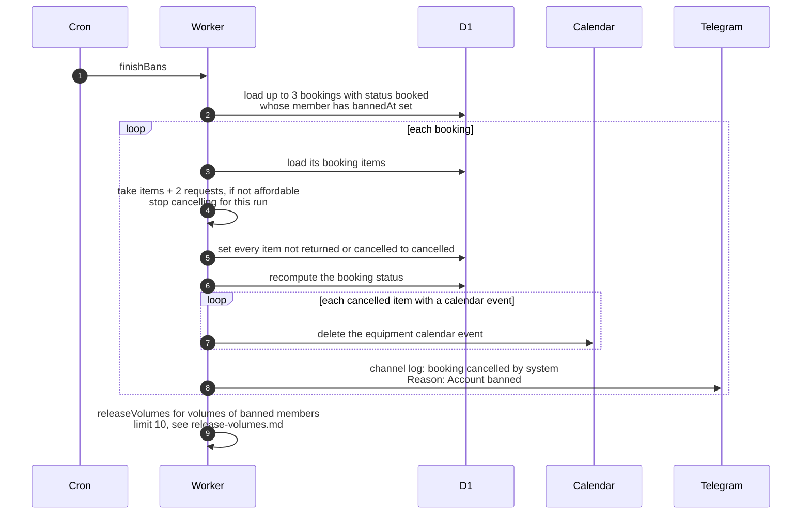

# What the cron does after a member is banned

> **Question:** After an admin bans a member, what does the
> finishBans step still do for them?
>
> **Answer:** Each run it cancels up to 3 upcoming (booked)
> bookings of banned members and releases up to 10 volume
> folders that banned flamekeepers had write access to.
> Cancelling marks every item of the booking cancelled, removes
> the equipment calendar events and posts a line to the club
> Telegram channel with the reason Account banned. The member is
> not messaged. Bookings already picked up (active or overdue)
> are not touched.
>
> **Notes:**
> - The ban itself, which signs the member out and starts a
>   14-day drain of a flamekeeper's photos with reason ban, is
>   done by the admin action, see ../admin/. The same two
>   cleanup tasks also run once straight after the ban, and the
>   cron repeats them until nothing is left.
> - A banned flamekeeper's photos follow the normal drain: no
>   reminder email to them, but admins are alerted, see
>   drain-notices.md. Their folders are released as volumes
>   empty, see release-volumes.md.
> - Cancelling needs the budget: items plus 2 requests per
>   booking. If it does not fit, the whole step for bookings
>   stops until next run.
> - A failure on one booking is logged and the next one is
>   tried.
> - The channel post shows the booking as cancelled by system
>   with Reason: Account banned.
> - Unbanning does not bring cancelled bookings back.

