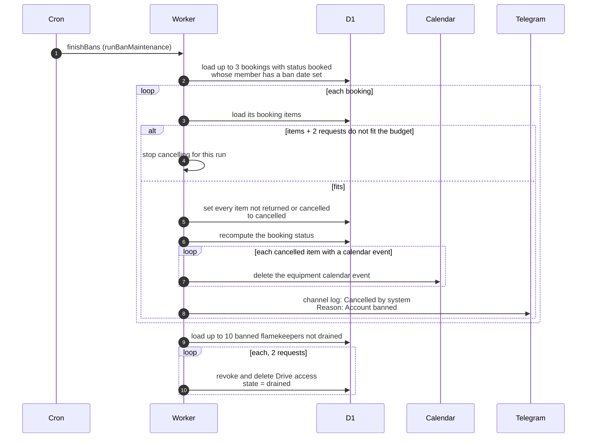

# What the cron does after a member is banned

> **Question:** After an admin bans a member, what does the
> finishBans step still do for them?
>
> **Answer:** Each run it cancels up to 3 upcoming (booked)
> bookings of banned members, then ends the flamekeeping of up to
> 10 banned flamekeepers who are not yet drained (stored Drive
> access revoked and deleted, state drained). Cancelling marks
> each item not yet returned as cancelled, removes its equipment
> calendar event and posts a line to the club Telegram channel,
> cancelled by system, with the reason Account banned. The member
> is not messaged. Bookings already picked up (active or overdue)
> are not touched.
>
> **Notes:**
> - The ban itself signs the member out and ends a flamekeeper's
>   flamekeeping at once, see ../../admin/ban-member.md. It also
>   runs the same two cleanup tasks once straight away, with no
>   request limit, and the cron repeats them until nothing is
>   left.
> - Nothing is held on flamekeepers, so no photos move on a ban.
>   The volume-folder release and drain alerts were removed in
>   #24 (last `dev` commit containing them: `2565826`).
> - Cancelling needs the budget: the booking's items plus 2
>   requests. If that does not fit, no more bookings are
>   cancelled in this run, and the flamekeeper step still runs.
>   Each ending costs 2 requests.
> - A failure on one booking or flamekeeper is logged and the
>   next one is tried.
> - Unbanning does not bring cancelled bookings back.

