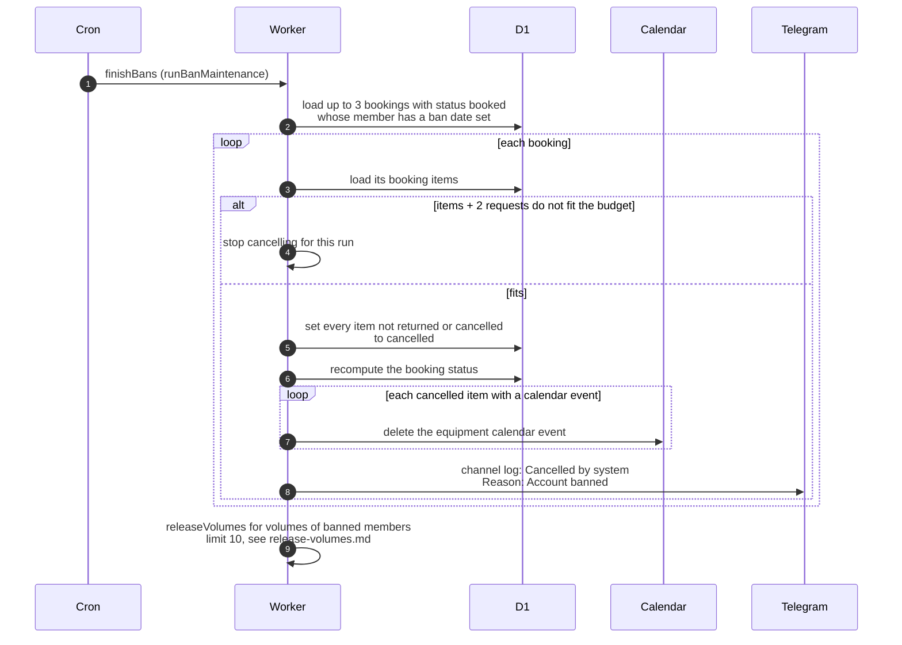

# What the cron does after a member is banned

> **Question:** After an admin bans a member, what does the
> finishBans step still do for them?
>
> **Answer:** Each run it cancels up to 3 upcoming (booked)
> bookings of banned members, then removes the write access of
> banned flamekeepers by deleting up to 10 of their empty album
> volume folders. Cancelling marks each item not yet returned
> as cancelled, removes its equipment calendar event and posts
> a line to the club Telegram channel, cancelled by system,
> with the reason Account banned. The member is not messaged.
> Bookings already picked up (active or overdue) are not
> touched.
>
> **Notes:**
> - The ban itself signs the member out and starts a 14-day
>   drain of a flamekeeper's photos with reason ban. The admin
>   action does that, see ../../admin/ban-member.md. It also
>   runs the same two cleanup tasks once straight away, with no
>   request limit, and the cron repeats them until nothing is
>   left.
> - A banned flamekeeper's photos follow the normal drain: no
>   reminder email to them, but admins are alerted, see
>   drain-notices.md. A folder is only deleted once it holds no
>   photos and no live upload slot, see release-volumes.md.
> - Cancelling needs the budget: the booking's items plus 2
>   requests. If that does not fit, no more bookings are
>   cancelled in this run, and the folder step still runs.
> - A failure on one booking is logged and the next one is
>   tried.
> - Unbanning does not bring cancelled bookings back.

