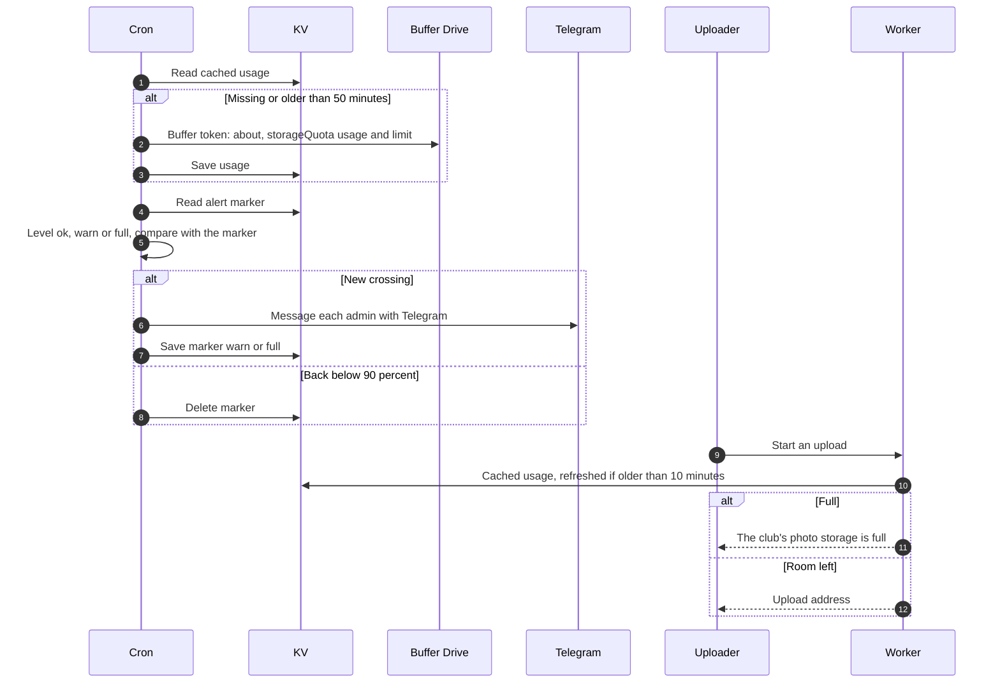

# Buffer usage, the 90% warning and the 100% stop

> **Question:** How do admins learn the buffer is filling up, who else is told, and what happens to uploads when it is full?
>
> **Answer:** The cron step checkBufferUsage reads how much of its plan the buffer account has used, from the Drive quota, using the buffer's `drive.file` token. The reading is cached in KV for up to an hour (50 minutes in the cron, 10 minutes when an upload or the dashboard asks). From 90 percent every admin with a linked Telegram account gets one message, and from 100 percent one more. A marker in KV remembers the last level that was announced, so nothing repeats while usage stays high, and the marker clears when usage drops below 90 percent, which re-arms the warning. From 90 percent `@nu.edu.kz` users see a banner asking for flamekeepers. At 100 percent a new upload is refused before any bytes are sent, with a plain message, and the file stays in the uploader's browser.
>
> **Notes:**
> - Levels: below 90 percent is fine, 90 percent up to just under 100 is a warning, 100 percent and over is full. If Google reports no plan limit the level is fine.
> - Falling from full back to a warning does not message anyone. Climbing from a warning to full does.
> - The marker is written only after the Telegram message was sent (or when nothing needs sending). If there are no admins with Telegram or the run's budget is short, the next hourly run tries again.
> - The step costs 4 outside requests when it refreshes the reading (token, quota, KV) and nothing when the cache is fresh. It is skipped while the buffer is not configured.
> - The banner reads only the cached reading, never Google, and is shown only to emails ending `@nu.edu.kz`, not to alumni. It does not mention storage; it links to the profile.
> - Nothing falls back to flamekeepers. The Free up space panel on the dashboard Albums tab is how admins make room.
> - A quota error from Google during the browser upload (the cache was stale) fails the job at once with the same message, instead of being retried as a temporary failure. See ../../albums/upload-failures.md.
> - Messages: admins get "#savenuimg buffer is N% full ..." or "#savenuimg buffer is full ...". Uploaders get "The club's photo storage is full, so uploads are paused. Your photos are still on your device and nothing was lost. Please tell an admin."

