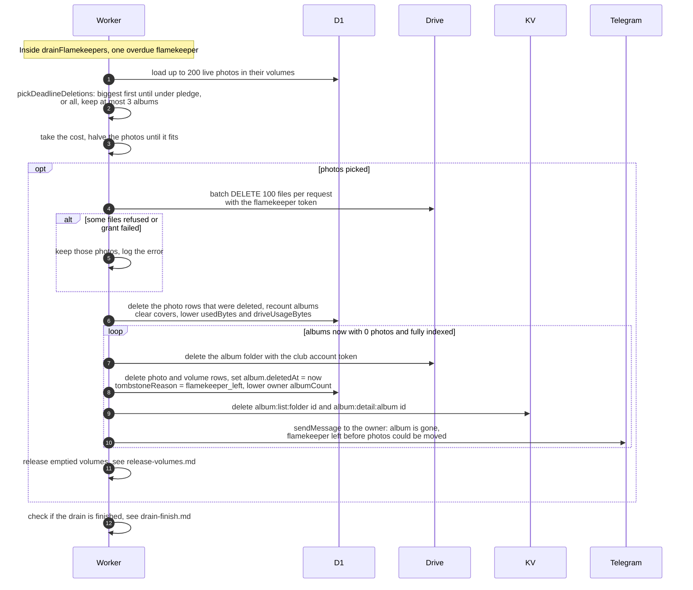

# What happens when a drain deadline passes

> **Question:** If a draining flamekeeper still holds photos
> after the 14-day deadline, what does the cron delete?
>
> **Answer:** Each run picks one overdue flamekeeper at random
> and deletes their photos from their own Drive in the next
> step: up to 200 photos from at most 3 albums. For a pledge
> drain only the biggest photos are chosen, until the
> flamekeeper is back within the pledge. For every other reason
> all loaded photos go. The deleted photos are removed from the
> albums. Albums left with no photos are hidden and their owner
> is told on Telegram. Photos that could not be deleted stay for
> the next run.
>
> **Notes:**
> - All Drive deletes use the draining flamekeeper's own token,
>   in batches of 100 files per request. A file already gone
>   (404) counts as deleted. Nothing is moved, copies are only
>   ever made by the flamekeeper's browser, see
>   ../../flamekeepers/.
> - Cost: 1 plus (photos divided by 100, rounded up), plus 1,
>   plus 3 per album. If that does not fit in the budget, the
>   number of photos is halved until it fits, or the step does
>   nothing but check progress.
> - If Drive answers 401 and the token was cached, the token is
>   dropped and tried once more, costing 2 more requests. If the
>   grant is refused (FlamekeeperGrantError), the delete is
>   logged as Drive grant failed, retrying later.
> - Hiding an album uses the club account token, deletes its
>   Drive folder and database rows, and marks it with reason
>   flamekeeper_left. Only albums that have been fully indexed
>   and have 0 photos are hidden. Owner message: Your album
>   "title" is gone. The flamekeeper who stored its photos left
>   the initiative before they could be moved, so the photos
>   were deleted. A link follows. It is paid for by the 3
>   requests per album in the cost above.
> - Used bytes and Drive usage of the flamekeeper go down by the
>   deleted photos.
> - The drain is checked for completion right after, see
>   drain-finish.md.

