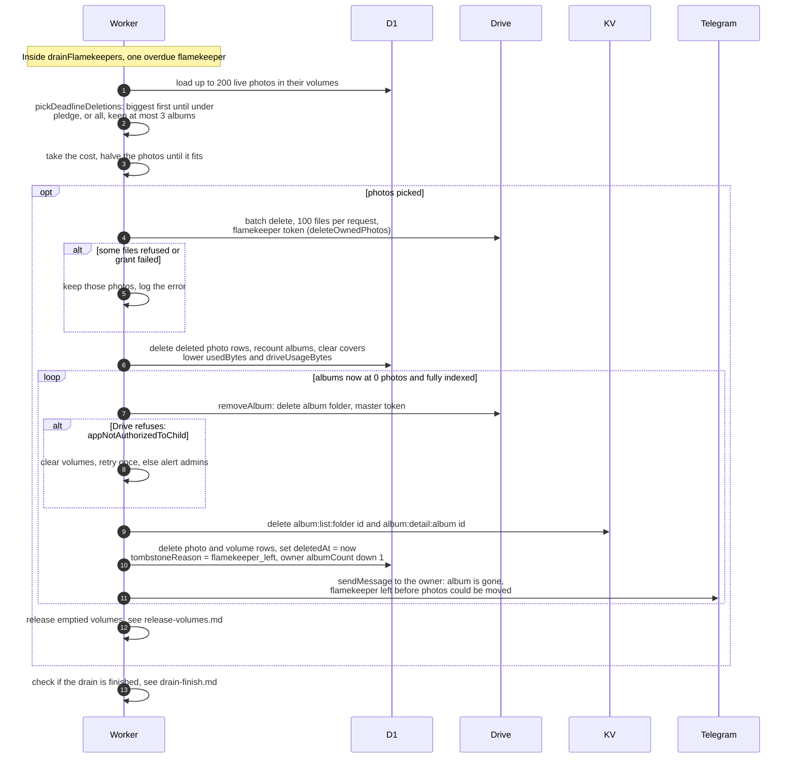

# What happens when a drain deadline passes

> **Question:** If a draining flamekeeper still holds photos
> after the 14-day deadline, what does the cron delete?
>
> **Answer:** Each run picks one overdue flamekeeper at random
> and deletes their photos from their own Drive: up to 200
> photos from at most 3 albums. For a pledge drain only the
> biggest photos among those loaded are chosen, until the
> flamekeeper is back within the pledge. For every other reason
> all loaded photos go. The deleted photos are removed from the
> albums. An album left with no photos is hidden and its owner
> is told on Telegram. Photos that could not be deleted stay
> for the next run.
>
> **Notes:**
> - Photo deletes use the draining flamekeeper's own Drive
>   token, 100 files per request. A file already gone (404)
>   counts as deleted. Nothing is moved by the cron. Copies are
>   only made by the flamekeeper's browser, see
>   ../../flamekeepers/relay-move-photo.md.
> - Cost: 1 plus (photos divided by 100, rounded up), plus 1,
>   plus 3 per album. If that does not fit the budget, the
>   number of photos is halved until it fits, or nothing is
>   deleted and the step only checks progress.
> - If Drive rejects a cached token, the token is dropped and
>   tried once more, costing 2 more requests. If the Drive
>   grant is refused, the run only logs that it will retry later.
> - Hiding an album uses the club account (master) token. It
>   first deletes any remaining photos of the album from their
>   flamekeepers, then deletes the album's Drive folder. If
>   Drive refuses that delete because the folder still holds
>   files the club account cannot remove, the cron first clears
>   the volumes, as in release-volumes.md, and retries once. If
>   it is still blocked, it tells the admins, and the album is
>   hidden in the app anyway.
> - Only albums that have been fully indexed and now show 0
>   photos are hidden. Others stay as they are.
> - Hiding marks the album with reason flamekeeper_left and
>   lowers the owner's album count. The owner is messaged only
>   if the owner has linked Telegram. Message: Your album
>   "title" is gone. The flamekeeper who stored its photos left
>   the initiative before they could be moved, so the photos
>   were deleted. A link to the album follows.
> - The flamekeeper's used bytes and Drive usage go down by the
>   deleted photos.
> - Emptied volume folders are then released with no request
>   limit, see release-volumes.md. The drain is checked for
>   completion right after, see drain-finish.md.

