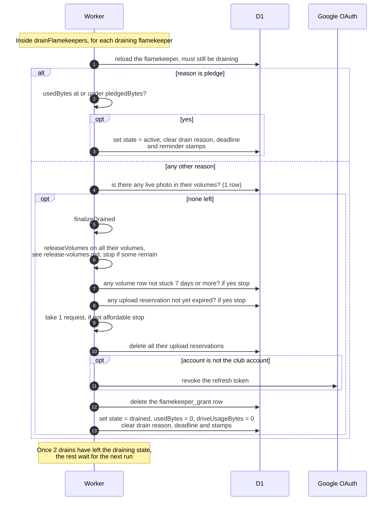

# How a drain ends

> **Question:** When does a flamekeeper stop draining, and what
> is cleaned up when they are fully drained?
>
> **Answer:** On every run, drainFlamekeepers checks each
> draining flamekeeper and lets at most 2 leave the draining
> state. For a pledge drain, the flamekeeper goes back to
> active as soon as their used space is within the pledge. For
> every other reason, the drain ends when no live photo is left
> in their volumes. Then the cron deletes their empty volume
> folders, revokes their Google grant and sets the state to
> drained with the byte counters at zero. If anything still
> blocks it, nothing changes and the check repeats next run.
>
> **Notes:**
> - The same check also runs when the flamekeeper opens their
>   account page and after each photo move, with its own budget
>   of 20 requests, see ../../flamekeepers/relay-confirm.md.
> - Before the grant is dropped, these must all hold: the
>   volume folders were released (see release-volumes.md), no
>   volume row is left unless it has been stuck for 7 days or
>   more, and no upload slot is still valid. A volume stuck for
>   7 days or more no longer holds the drain back, and the
>   admins were alerted about it, see drain-notices.md.
> - Revoking asks Google to cancel the refresh token. It is
>   skipped, with a warning, if the account is the club account
>   (GOOGLE_MASTER_EMAIL), whose grant must never be revoked.
>   The grant row is deleted either way.
> - The club account (nu_image) cannot become a flamekeeper,
>   and upload placement skips it, so it never holds uploads
>   and never drains.
> - One random flamekeeper past its deadline gets deletes in
>   that run, the other overdue ones are only checked. See
>   drain-deadline.md.
> - Finishing costs 1 request from the shared budget in addition
>   to what releasing volumes costs.
> - A ban of a flamekeeper with no photos runs the same
>   finishing steps at once, with no request limit.

