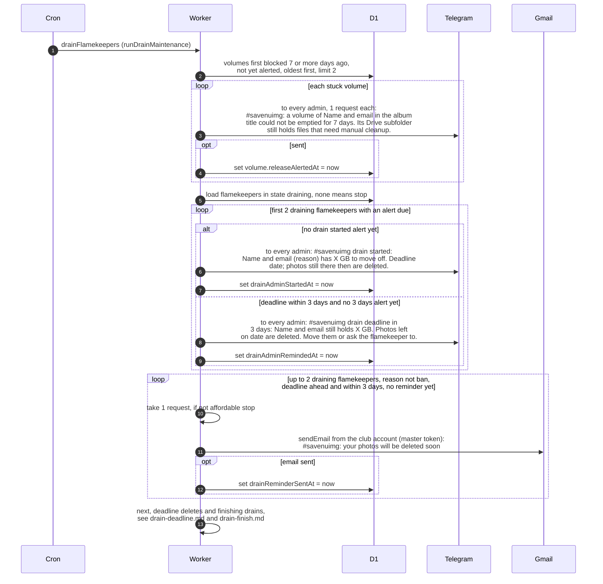

# Who is told during a flamekeeper drain

> **Question:** While a flamekeeper is draining (moving their
> photos off their Drive), which warnings do the admins and the
> flamekeeper get from the cron?
>
> **Answer:** Each run, drainFlamekeepers first alerts admins
> about album folders that have been stuck for 7 days. Then it
> looks at flamekeepers who are draining. Admins get a "drain
> started" message once per drain, and a "3 days left" message
> once when the deadline is within 3 days. The flamekeeper gets
> one reminder email when 3 days or fewer remain, unless the
> drain is a ban. Each message is recorded in the database so
> it goes out only once.
>
> **Notes:**
> - A drain gives 14 days from its start to the deadline. Photos
>   still on the flamekeeper's Drive at the deadline are
>   deleted, see drain-deadline.md.
> - Reasons a drain starts: opt_out, pledge, graduation, domain,
>   ban. Graduation and domain drains start in
>   graduation-trigger.md, bans in ban-cleanup.md.
> - Per run there are at most 2 stuck-folder alerts, 2 drain
>   alerts and 2 reminder emails.
> - Admin messages go to every admin who has a Telegram chat
>   and cost 1 request per admin. If there is no such admin or
>   the budget is short, the message is not recorded, that
>   alert loop stops, and the next run tries again. If the bot
>   token is missing, the alert is skipped but still recorded.
> - The reminder email is sent from the club account and costs
>   1 request. It is recorded only if the send worked.
> - Reminder email subject: #savenuimg: your photos will be
>   deleted soon. Body: how many GB are still with them, the
>   date the unmoved photos are deleted, and a link to their
>   account page, asking them to keep the tab open to move them.
> - Banned flamekeepers are skipped for the reminder email.
> - The GB left is the full amount held for most reasons, and
>   only the part above the pledge for a pledge drain.
> - In the admin messages, Name and email are written as
>   Name followed by the email in angle brackets. The reason
>   in the drain started message is the raw word, such as ban.
> - Moving the photos happens in the flamekeeper's browser, see
>   ../../flamekeepers/relay-move-photo.md.

