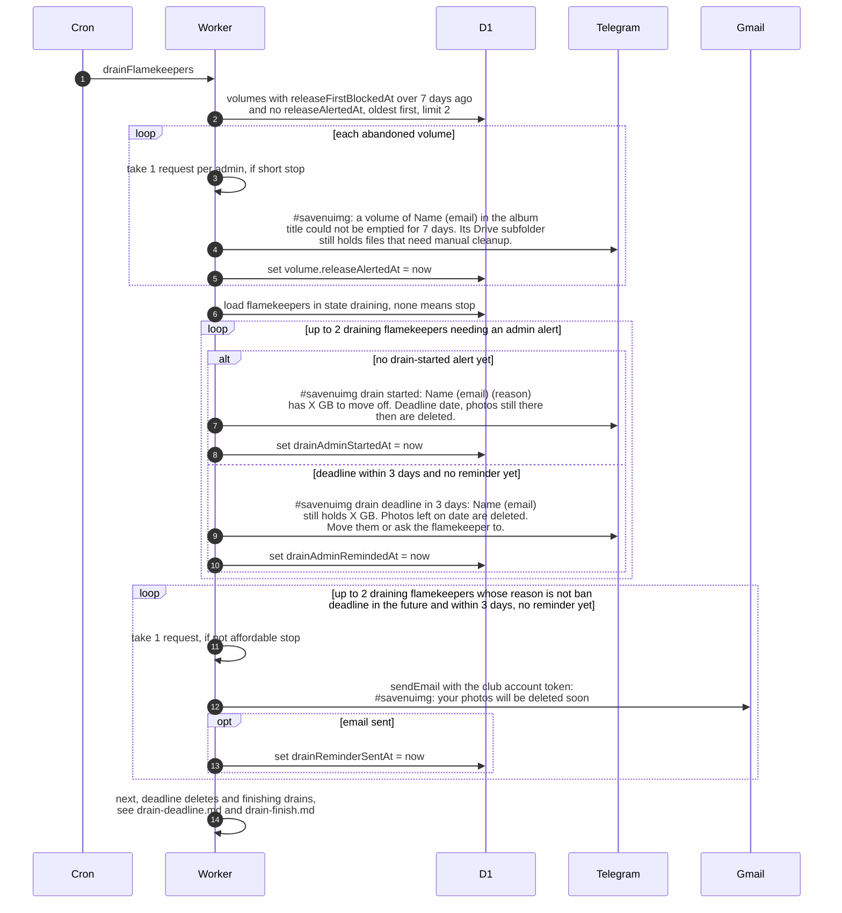

# Who is told during a flamekeeper drain

> **Question:** While a flamekeeper is draining (moving their
> photos off their Drive), which warnings do the admins and the
> flamekeeper get from the cron?
>
> **Answer:** Every run, drainFlamekeepers first alerts admins
> about volumes that could not be emptied for 7 days. Then, for
> flamekeepers in state draining, it sends admins a "drain
> started" message once, and a "3 days left" message once when
> the deadline is within 3 days. The flamekeeper gets one
> reminder email when 3 days or less remain, except when the
> drain is a ban. At most 2 admin alerts and 2 reminder emails
> go out per run, and each is stamped in the database so it is
> sent only once.
>
> **Notes:**
> - A drain gives 14 days from its start to the deadline. Photos
>   still on the flamekeeper's Drive at the deadline are
>   deleted, see drain-deadline.md.
> - Reasons a drain starts: opt_out, pledge, graduation, domain,
>   ban. Graduation and domain drains start from
>   graduation-trigger.md, bans from ban-cleanup.md.
> - Admin messages go to every admin with a Telegram chat id and
>   cost 1 request per admin. If there is no admin or the budget
>   is short, the message is not stamped and the loop stops, so
>   it is retried next run.
> - The reminder email costs 1 request. It is stamped only if
>   the email was sent.
> - Reminder email subject: #savenuimg: your photos will be
>   deleted soon. Body: how many GB are still with them, the
>   date the unmoved photos are deleted, and a link to the
>   account page asking them to keep the tab open to move them
>   now.
> - Banned flamekeepers get no reminder email, because they are
>   signed out.
> - The remaining GB is the used bytes for most reasons, and
>   only the part above the pledge for a pledge drain.
> - Moving the photos is done in the flamekeeper's browser, see
>   ../../flamekeepers/.

