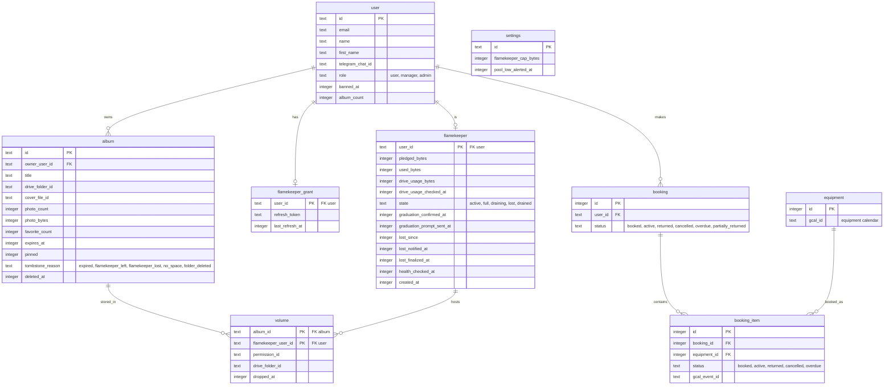

# Tables used by the flamekeeper cron steps

> **Question:** Which tables and columns do the flamekeeper cron
> steps read and write?
>
> **Answer:** The steps work on the flamekeeper, its Drive
> grant, and the global settings row. The volume table is no longer read by these steps (#24), and
> the photo and upload reservation tables no longer exist (#25). They
> also read users (email, Telegram chat, ban) and, for banned
> members, bookings, booking items and the equipment calendar
> each item was booked on.
>
> **Notes:**
> - KV keys album:list:(album Drive folder id), TTL 8 days
>   seconds, and album:detail:(album id), TTL 3600 seconds,
>   are only deleted by these steps, never written.
> - R2 is not used by these steps.
> - The drain deadline, reason and reminder columns and health_cursor
>   were removed in #25.

