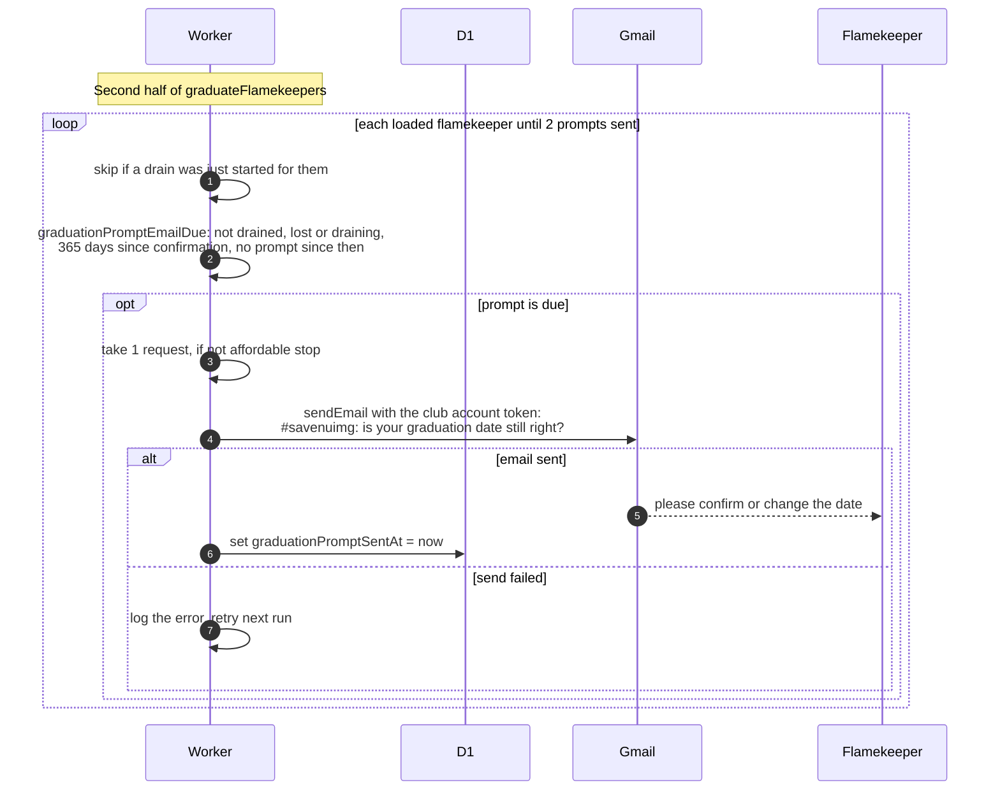

# How flamekeepers are asked to confirm their graduation date

> **Question:** When does a flamekeeper get an email asking them
> to check their graduation date?
>
> **Answer:** A year after they last confirmed the date (or
> after they became a flamekeeper, if they never confirmed),
> graduateFlamekeepers emails them once to ask whether the
> expected graduation date is still right. Up to 2 such emails
> go out per run, 1 request each. Flamekeepers who are draining,
> drained or lost get none, and nobody who just had a drain
> started in the same run. Ignoring the email changes nothing by
> itself.
>
> **Notes:**
> - The year is 365 days from graduationConfirmedAt, which is
>   set when the flamekeeper saves their pledge and date in the
>   app.
> - Only one email is sent per year: the send time is stored and
>   a new one is due only after the next anniversary.
> - Subject: #savenuimg: is your graduation date still right?
>   Body: the saved date, a note that photos are moved 60 days
>   before it, a request to confirm or change it, and a link to
>   the account page.
> - If the email fails to send, nothing is stored and it is
>   tried again next run.
> - What happens when the date is near is in
>   graduation-trigger.md.

