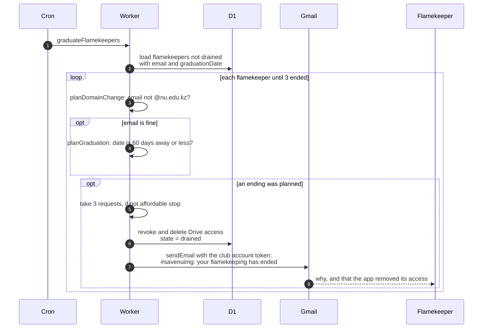

# How graduation and non-university emails end flamekeeping

> **Question:** When does the cron end someone's flamekeeping
> because they are graduating or their email changed?
>
> **Answer:** graduateFlamekeepers checks every flamekeeper who
> has not stopped (active, full, draining or lost). A flamekeeper
> whose email no longer ends in @nu.edu.kz is ended with reason
> domain. Otherwise, when their expected graduation date is 60
> days away or closer, they are ended with reason graduation.
> Ending means the stored Drive access is revoked and deleted and
> the state becomes drained. Up to 3 per run, 3 requests each.
> The flamekeeper gets a short email saying why; there is nothing
> for them to do.
>
> **Notes:**
> - Nothing is held on a flamekeeper's Drive, so there are no
>   photos to move and no deadline. The old drain, with its
>   reminders, relay and deletions, was removed in #24 (last
>   `dev` commit containing it: `2565826`).
> - Email subject: #savenuimg: your flamekeeping has ended. It
>   says why (for graduation: Your expected graduation date is
>   less than 60 days away; for domain: Your account is no longer
>   an @nu.edu.kz account, so it cannot keep lending storage) and
>   that the app has removed its access to the Drive.
> - The requests are taken before the work. If they do not fit
>   in the budget, the loop stops.
> - The same graduation rule runs when a flamekeeper saves a
>   nearer graduation date in the app, see
>   ../../flamekeepers/change-pledge.md.

