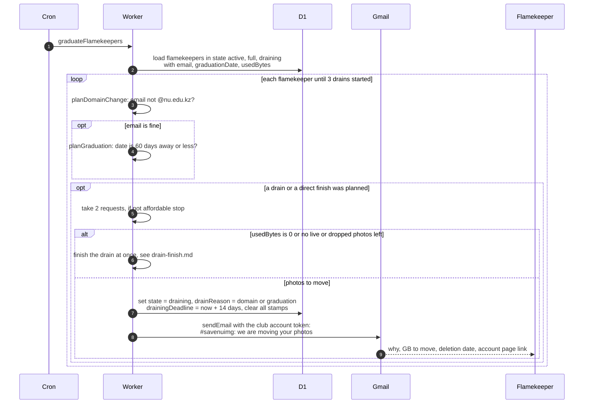

# How graduation and non-university emails start a drain

> **Question:** When does the cron start moving photos off a
> flamekeeper's Drive because they are graduating or their email
> changed?
>
> **Answer:** graduateFlamekeepers checks flamekeepers in state
> active, full or draining. A flamekeeper whose email no longer
> ends in @nu.edu.kz is drained with reason domain. Otherwise,
> when their expected graduation date is 60 days away or closer,
> they are drained with reason graduation. Up to 3 drains start
> per run, 2 requests each. The flamekeeper is told by email
> that their photos must move within 14 days. If they hold no
> photos, they go straight to drained.
>
> **Notes:**
> - A draining flamekeeper with reason pledge or graduation
>   whose email is not @nu.edu.kz is switched to a domain drain,
>   and a pledge drain turns into a graduation drain when the
>   date is near. Both restart the 14-day deadline.
> - A graduation drain whose date was moved later is not
>   cancelled by the cron. Only the flamekeeper's own edit in
>   the app does that.
> - Email subject: #savenuimg: we are moving your photos. It
>   says why (for graduation: Your expected graduation date is
>   less than 60 days away and your account is about to move to
>   alumni storage, for domain: Your account is no longer an
>   @nu.edu.kz account, so it cannot keep lending storage), how
>   many GB must move, to keep the account page open, and the
>   deletion date.
> - The 2 requests are taken before the work. If they do not fit
>   in the budget, the loop stops.
> - The drain itself continues in drain-notices.md,
>   drain-deadline.md and drain-finish.md. The move of the
>   photos is in ../../flamekeepers/.
> - Flamekeepers without photos (used bytes 0, or no live or
>   dropped volumes) skip the drain and are finished at once,
>   see drain-finish.md.

