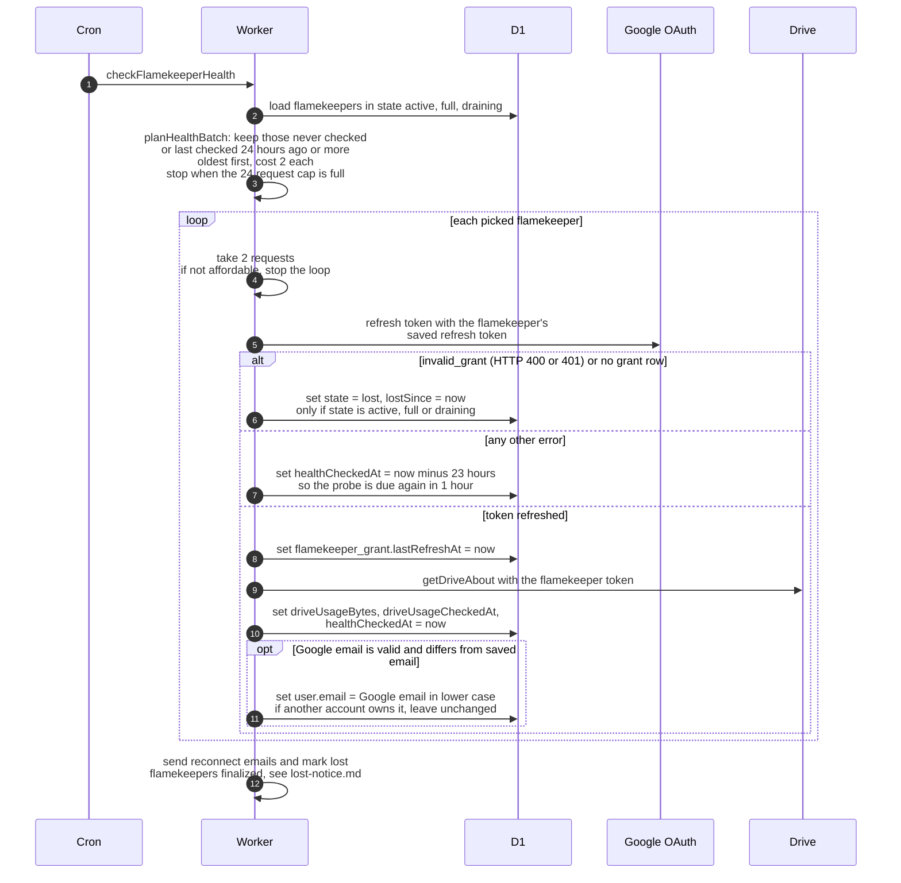

# How the daily flamekeeper health probe works

> **Question:** How often does the cron check that each
> flamekeeper's Google Drive still works, and what happens when
> the check fails?
>
> **Answer:** checkFlamekeeperHealth looks at flamekeepers in
> state active, full or draining and probes each one at most
> once every 24 hours, oldest check first. The probe refreshes
> the flamekeeper's Google token, records the Drive usage, and
> copies Google's email onto the account if it differs. If Google
> says the grant is gone (invalid_grant, or no grant row at all),
> the flamekeeper is marked lost. Any other failure is retried in
> about 1 hour. The probes share a cap of 24 requests, taken
> from the run's 40.
>
> **Notes:**
> - Cost per flamekeeper is 2 requests (token refresh and Drive
>   about call). The pick stops at the first flamekeeper that no
>   longer fits.
> - The probe works on the grant alone. It does not look at
>   photos: nothing is held on flamekeepers, and the old photo
>   check was removed in #24 (last `dev` commit containing it:
>   `2565826`).
> - The reconnect emails that follow use the run's budget outside
>   the cap of 24, see lost-notice.md.
> - The cached token is always thrown away first, so every probe
>   uses a fresh token. A token is otherwise cached for 50
>   minutes.
> - Only active, full and draining flamekeepers are probed. A
>   lost flamekeeper is not probed again until it reconnects,
>   which puts it back to active, see
>   ../../flamekeepers/drive-callback.md.
> - If Google reports no email for the account, the email sync
>   is skipped and a warning is logged once per Worker instance.

