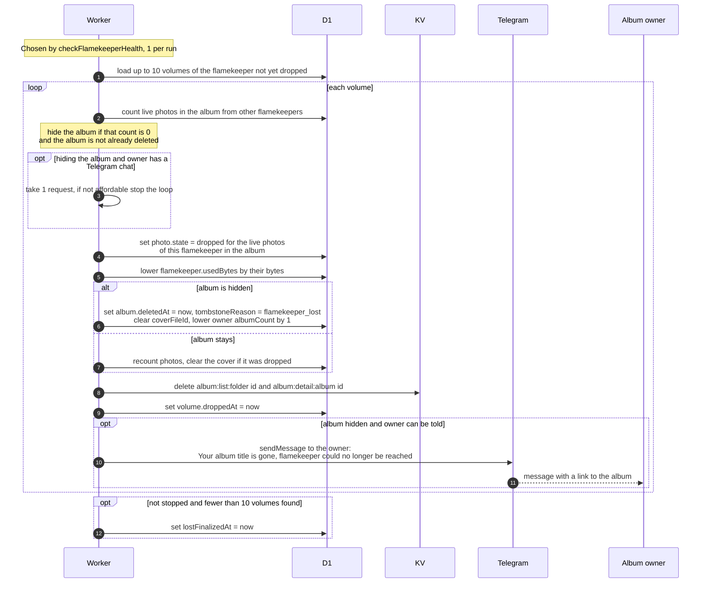

# What happens to photos 7 days after a flamekeeper is lost

> **Question:** If a flamekeeper never reconnects, what happens
> to the photos and albums they stored?
>
> **Answer:** Seven days after the loss, the cron marks that
> flamekeeper's live photos as dropped, so they disappear from
> the albums, and hides every album that has no other live
> photos. The files themselves are not touched in Drive. The
> album owner gets a Telegram message for each hidden album. One
> lost flamekeeper is finalized per run and at most 10 album
> volumes per run, so a large one takes several runs.
>
> **Notes:**
> - Dropped is reversible: if the flamekeeper reconnects later,
>   the photos come back, see lost-recovery.md.
> - The Telegram message to the owner is only sent if the owner
>   has a Telegram chat and the bot token is set. Each message
>   costs 1 request. When the budget has no room for it, the
>   loop stops and the flamekeeper is not marked finalized, so
>   the rest is done next run.
> - Message text: Your album "title" is gone. The flamekeeper
>   who stored its photos could no longer be reached, so the
>   album is hidden. If they reconnect their Drive before the
>   album expires, it comes back. A link to the album follows.
> - The flamekeeper is marked finalized (lostFinalizedAt) only
>   when fewer than 10 volumes were handled in the run and
>   nothing was stopped by the budget.
> - An album that still has live photos on other flamekeepers is
>   not hidden. It only loses this flamekeeper's photos and its
>   cover if the cover was one of them.

