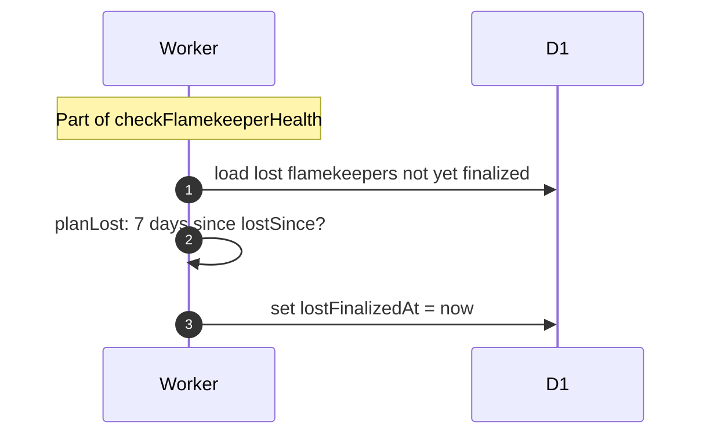

# What happens 7 days after a flamekeeper is lost

> **Question:** If a flamekeeper never reconnects, what happens
> after the 7-day window?
>
> **Answer:** Nothing visible. The cron only stamps the
> flamekeeper as finalized (lostFinalizedAt) so the step stops
> looking at them. No photos are held on flamekeepers, so no
> album loses photos or is hidden. The flamekeeper stays lost and
> can still reconnect from the My Account page, which makes them
> active again.
>
> **Notes:**
> - Before #24 this step dropped the flamekeeper's photos and
>   hid albums left empty, and a reconnect brought them back.
>   That code was removed (last `dev` commit containing it:
>   `2565826`). Stage 2 of #15 may bring a rescue copy back.
> - The reconnect email that opens the window is in
>   lost-notice.md.

