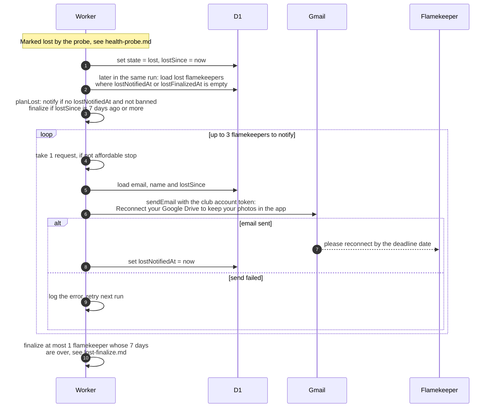

# What happens when a flamekeeper's Drive connection breaks

> **Question:** When Google no longer accepts a flamekeeper's
> connection, who is told and how long do they have?
>
> **Answer:** The flamekeeper is marked lost and, unless banned,
> gets one email asking them to reconnect Drive before a date 7
> days after the loss. Up to 3 such emails go out per cron run,
> 1 request each. Their photos stay listed during the 7 days.
> When the 7 days have passed, the cron finalizes the loss (see
> lost-finalize.md). If the email fails to send, it is tried
> again on the next run.
>
> **Notes:**
> - A flamekeeper in state lost no longer receives uploads:
>   placement only looks at active flamekeepers.
> - The email goes out in the same run that marks the loss,
>   right after the probes.
> - If the budget is gone or the cap of 3 is reached, the rest
>   wait for the next run.
> - Banned flamekeepers get no reconnect email, but are still
>   finalized after 7 days.
> - The email is sent from the club account. Subject: Reconnect
>   your Google Drive to keep your photos in the app. The body
>   gives the deadline date and a link to /profile, and says the
>   files stay in the flamekeeper's Drive and come back if they
>   reconnect later.
> - Reconnecting is done by the flamekeeper in the app, see
>   ../../flamekeepers/connect-drive.md. The restoration after
>   it is in lost-recovery.md.
> - How the loss is detected is in health-probe.md.

