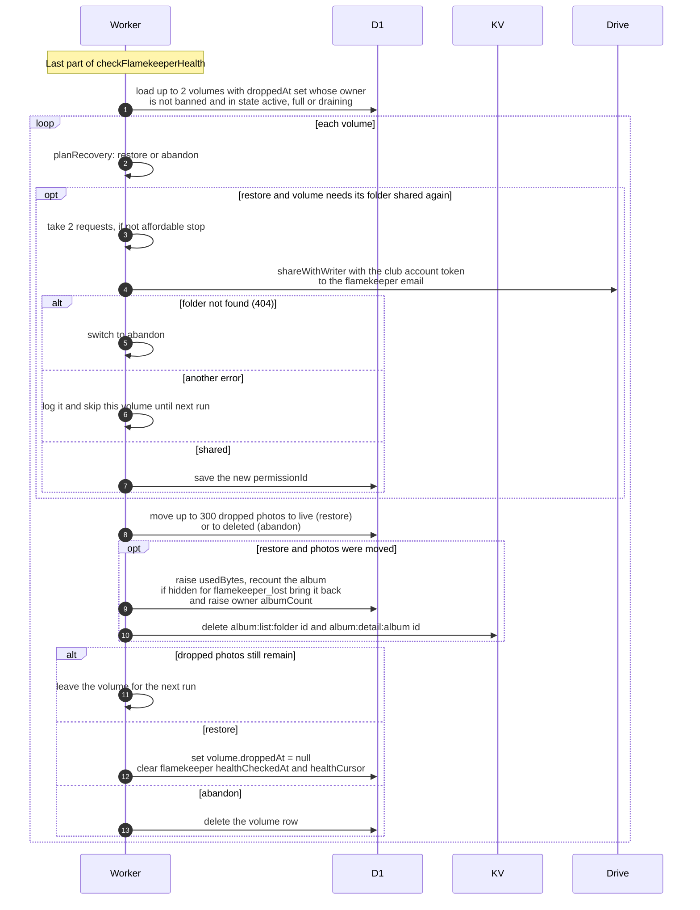

# How dropped photos come back after a flamekeeper reconnects

> **Question:** When a lost flamekeeper reconnects their Drive,
> how do their dropped photos and hidden albums return?
>
> **Answer:** Each run, checkFlamekeeperHealth looks at up to 2
> dropped volumes whose flamekeeper is active, full or draining
> again and not banned. For each one it either restores the
> volume or abandons it. Restoring turns up to 300 dropped
> photos per run back to live, brings back an album that was
> hidden because of the loss, and re-shares the folder if
> needed. Abandoning turns the dropped photos into deleted ones
> and removes the volume. A volume with more than 300 dropped
> photos takes several runs.
>
> **Notes:**
> - Abandon is chosen when the album was deleted for any reason
>   other than flamekeeper_lost, or when it is not pinned and
>   its expiry date has already passed. Otherwise the volume is
>   restored.
> - Re-sharing only happens when the volume has a folder, no
>   photo rows and no permission id. It uses the club account
>   token and costs 2 requests. If the budget cannot pay, the
>   loop stops. If the folder is gone in Drive (404), the volume
>   is abandoned. Any other error skips the volume until the
>   next run.
> - When a volume is fully restored, the flamekeeper's health
>   check time and cursor are cleared so the next probe audits
>   them again at once.
> - The reconnect itself happens in the app, see
>   ../../flamekeepers/drive-callback.md.
> - No message is sent to anyone when an album comes back.

