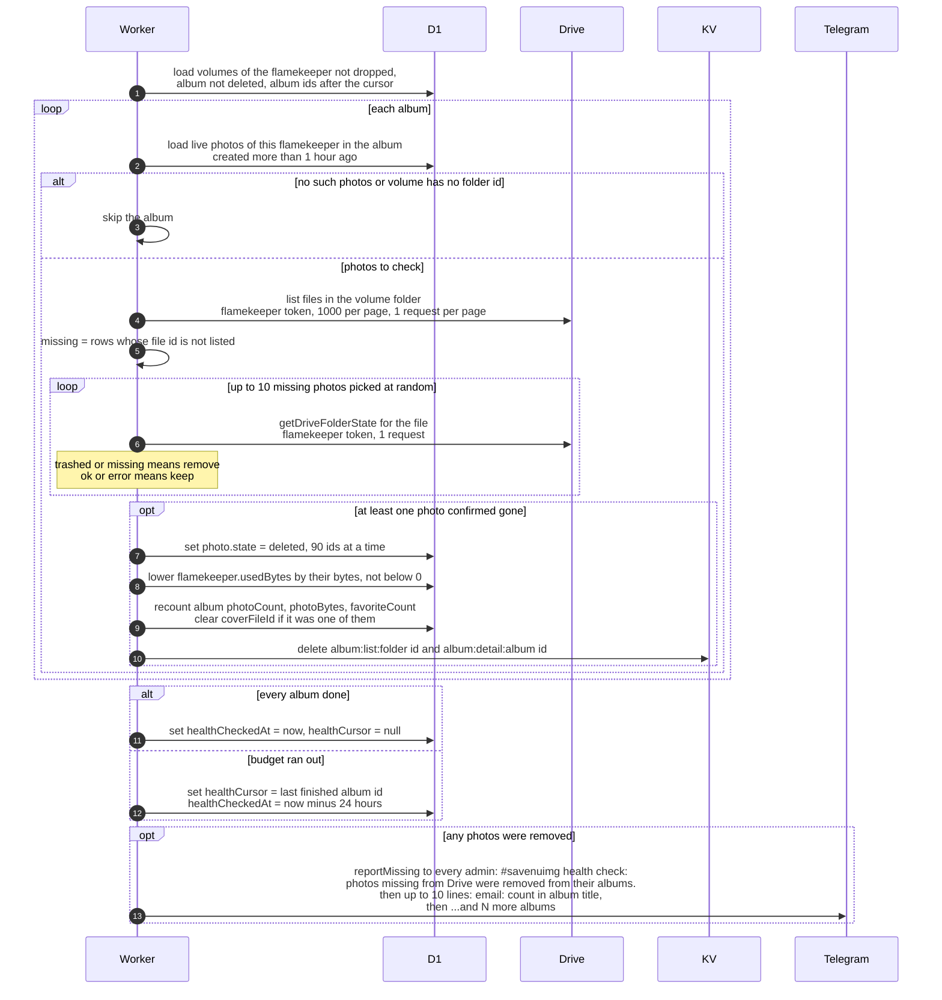

# How photos missing from Drive are found and removed

> **Question:** What happens to a photo whose file has
> disappeared from the flamekeeper's Drive?
>
> **Answer:** During the health probe, the cron lists each album
> folder the flamekeeper hosts and compares it with the photo
> rows in the database. For photos that are older than 1 hour
> and absent from the listing, it asks Drive about up to 10 of
> them per album. Photos that Drive says are in the bin or
> permanently deleted are marked deleted in the database and
> removed from the album, and the admins get one Telegram
> message listing them. Photos that Drive still reports, or
> whose check failed, are kept. Nothing is ever deleted from
> Drive here.
>
> **Notes:**
> - Why 1 hour: photos newer than that are skipped, so a fresh
>   upload that is not yet visible in the listing is not
>   removed.
> - Why a second check: the folder listing alone is not trusted.
>   A photo is only removed once a direct Drive lookup says
>   trashed or missing (404).
> - Photos beyond the first 10 missing in an album are not
>   checked this run and are looked at again on the next probe.
>   The 10 are picked at random.
> - Every listing page (1000 files) and every lookup costs 1
>   request from the step's cap of 24. When the cap runs out,
>   the probe saves the last finished album as a cursor, sets
>   the check time to 24 hours ago so the flamekeeper is due
>   again at once, and continues in the next run.
> - An error on one album is logged and that album is skipped.
> - The admin message is sent even if the shared budget is
>   short: its cost is added without being refused. Only admins
>   with a Telegram chat id receive it.
> - Skipped when a volume has no folder id but has live photo
>   rows (a warning is logged).

