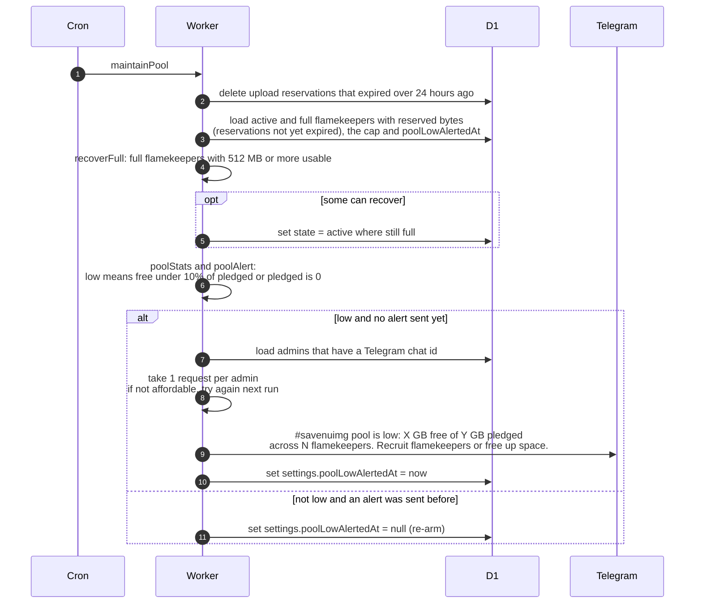

# How the storage pool is kept topped up

> **Question:** What does the cron do about the shared photo
> storage, and when are admins told that space is running low?
>
> **Answer:** maintainPool deletes old upload reservations, puts
> flamekeepers marked full back to active once they have at
> least 512 MB usable again, and checks whether the free space
> of the pool is under 10% of what was pledged (or nothing is
> pledged at all). If so, and no alert is already out, every
> admin with Telegram gets a low-space message. When space
> recovers, the alert is re-armed so it can fire again later. It
> adds no new flamekeepers or space by itself.
>
> **Notes:**
> - Usable space of a flamekeeper is the smaller of two: pledge
>   minus used minus reserved, and the per-account cap minus
>   Drive usage minus reserved. The cap comes from
>   settings.flamekeeperCapBytes, 20 GB by default.
> - A reservation is created when an upload starts and counts
>   for 2 hours. This step deletes reservations that expired
>   more than 24 hours ago.
> - Free space counts active flamekeepers only. Full ones add to
>   the pledged total but not to the free total.
> - The club account (master) is never given uploads: placement
>   skips the account whose email equals GOOGLE_MASTER_EMAIL.
> - The alert costs 1 request per admin. If admins have no
>   Telegram chat, or the budget is short, the alert is not
>   marked as sent and is tried again next run. If the bot token
>   is missing, the alert is counted as sent without sending.
> - A flamekeeper becomes full during an upload when Drive
>   answers that the quota is exceeded. A member trying to
>   upload with no room anywhere sees: Out of space, become a
>   flamekeeper / #savenuimg.
> - If the settings row does not exist, the step stops after the
>   recovery of full flamekeepers.

