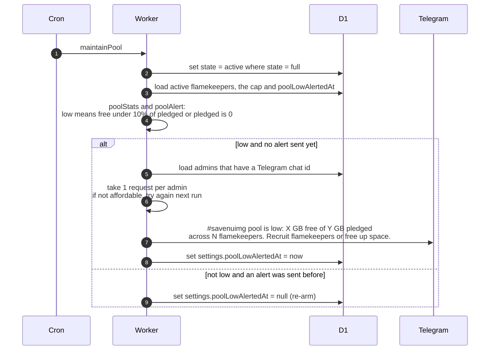

# How the storage pool is checked

> **Question:** What does the cron do about the flamekeeper pool,
> and when are admins told that pledged space is running low?
>
> **Answer:** maintainPool puts any flamekeeper still marked full
> back to active, and checks whether the free space of the pool
> is under 10% of what was pledged (or nothing is pledged at
> all). If so, and no alert is already out, every admin with
> Telegram gets a low-space message. When space recovers, the
> alert is re-armed so it can fire again later. It adds no new
> flamekeepers or space by itself.
>
> **Notes:**
> - Nothing is stored on flamekeepers until Stage 2 of #15, so
>   this step does little: no placement, reservations or upload
>   slots exist any more (removed in #24, last `dev` commit
>   containing them: `2565826`). Uploads go to the buffer, see
>   ../../albums/upload-to-buffer.md. The buffer's own usage
>   warning is in buffer-usage.md.
> - Usable space of a flamekeeper is the smaller of two: pledge
>   minus used, and the per-account cap minus Drive usage. The
>   cap comes from settings.flamekeeperCapBytes, 20 GB by default.
> - Free space counts active flamekeepers only. Full ones add to
>   the pledged total but not to the free total.
> - The alert costs 1 request per admin. If admins have no
>   Telegram chat, or the budget is short, the alert is not
>   marked as sent and is tried again next run. If the bot token
>   is missing, the alert is counted as sent without sending.
> - If the settings row does not exist, the step stops after
>   resetting full flamekeepers.

