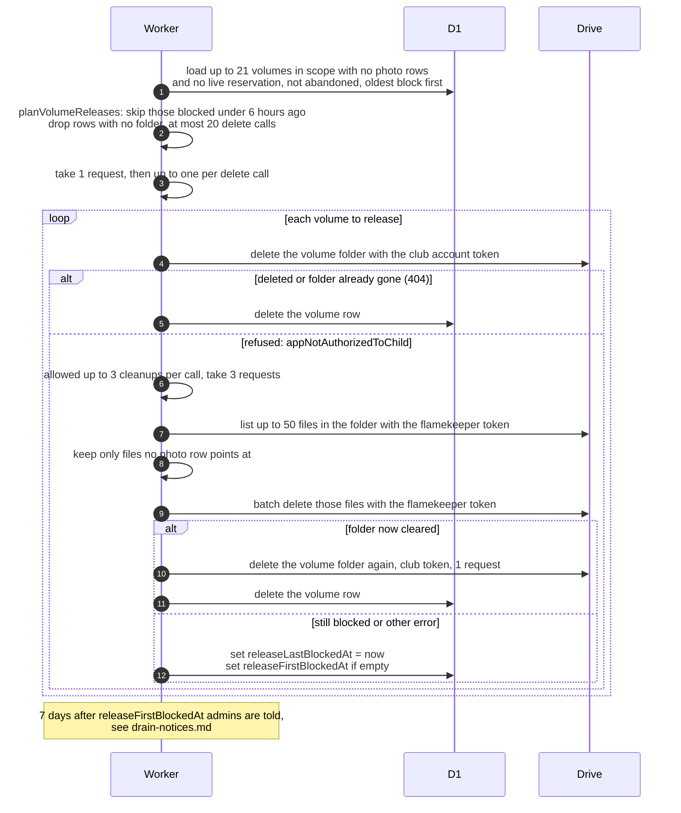

# How a flamekeeper's empty album folder is released

> **Question:** When a flamekeeper no longer holds photos in an
> album, how is their folder removed, and what happens when
> Drive refuses the deletion?
>
> **Answer:** The club account deletes the empty volume folder,
> which also removes the flamekeeper's write access to it, and
> the volume row is deleted. Up to 20 volumes are handled per
> call. If Drive refuses with appNotAuthorizedToChild, because
> the folder still holds files the club app did not create, the
> cron lists up to 50 files in the folder with the flamekeeper's
> token, deletes the ones no photo row points at, and tries the
> club delete again. A volume that stays blocked is retried
> every 6 hours, and after 7 days admins are alerted for a
> manual cleanup.
>
> **Notes:**
> - Only volumes with no photo rows (other than deleted), no
>   unexpired upload reservation, and not already alerted as
>   abandoned (blocked for 7 days or more) are considered.
> - Budget: 1 request to start, then 1 per folder delete
>   (granted as far as the budget allows). A cleanup attempt
>   costs 3, and a retry after it costs 1 more. A 401 retry on
>   the club token costs 2 more. Cleanup is tried at most 3
>   times per call.
> - A folder that is already gone (404) counts as released. A
>   volume without a folder id is simply dropped.
> - Cleanup is skipped if the flamekeeper has no grant row, if
>   the files in the folder belong to a photo row, or if the
>   volume has a photo row or live reservation. The result is
>   then blocked.
> - The blocked flags are cleared again when the volume is used
>   for an upload.
> - The 7-day alert text is in drain-notices.md. This step is
>   used by drain-finish.md, drain-deadline.md and
>   ban-cleanup.md.

