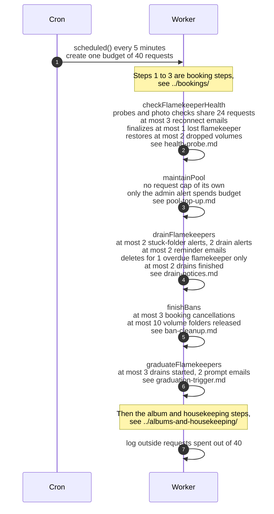

# The five flamekeeper steps of the cron and their limits

> **Question:** Which cron steps look after flamekeepers, in
> what order, and how much can each one do in a single 5-minute
> run?
>
> **Answer:** Five steps run one after another in every 5-minute
> run: checkFlamekeeperHealth, maintainPool, drainFlamekeepers,
> finishBans and graduateFlamekeepers. They come after the three
> booking steps and before the album steps. All steps share one
> budget of 40 outgoing requests per run, and each step also has
> its own caps on how many people, emails or photos it handles.
> If a step throws, the error is only logged and the next step
> still runs. A step that runs out of budget stops early and
> carries on in the next run.
>
> **Notes:**
> - The budget counts outgoing requests to Google and Telegram,
>   not database queries. Email sends are counted by the steps
>   that send them (1 each), and Telegram admin messages cost 1
>   per admin.
> - The budget of 40 is below the Worker limit of 50 outgoing
>   requests per run.
> - The photo health check has a slice of 24 requests inside the
>   40. The reconnect emails and the admin report of the same
>   step use the rest of the budget.
> - Photo moves between flamekeepers are not done by the cron.
>   The browser of the flamekeeper does them, see
>   ../../flamekeepers/relay-move-photo.md for that.
> - Each step has its own file: health-probe.md,
>   missing-photos.md, lost-notice.md, lost-finalize.md,
>   lost-recovery.md, pool-top-up.md, drain-notices.md,
>   drain-finish.md, drain-deadline.md, release-volumes.md,
>   ban-cleanup.md, graduation-trigger.md and
>   graduation-prompt.md.

