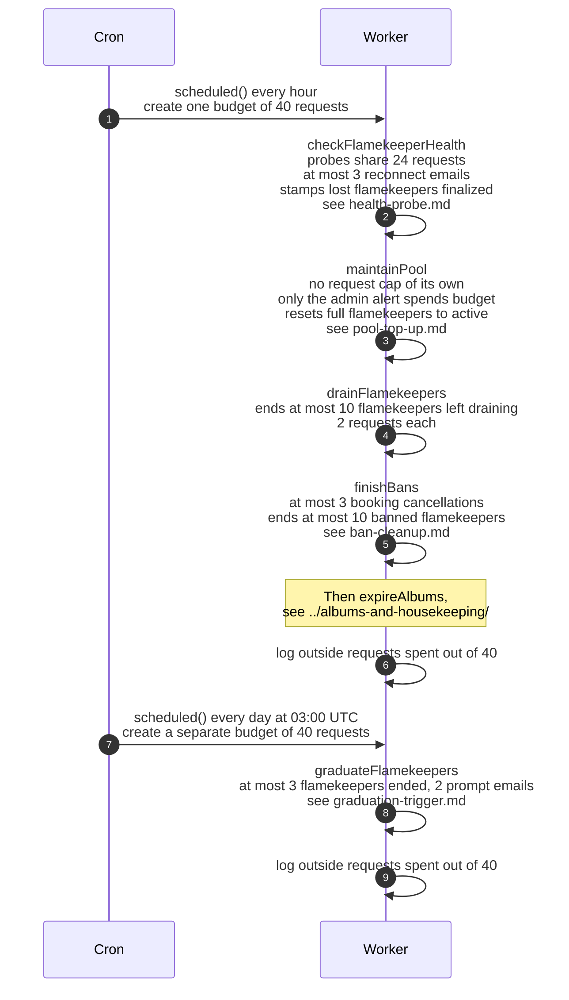

# The five flamekeeper steps of the cron and their limits

> **Question:** Which cron steps look after flamekeepers, in
> what order, and how much can each one do in a single run?
>
> **Answer:** Four steps run one after another in every hourly
> run: checkFlamekeeperHealth, maintainPool, drainFlamekeepers
> and finishBans, followed by expireAlbums. graduateFlamekeepers
> runs alone in the daily run at 03:00 UTC. The steps of one run
> share one budget of 40 outgoing requests, and each run has its
> own budget. Each step also has
> its own caps on how many people, emails or photos it handles.
> If a step throws, the error is only logged and the next step
> still runs. A step that runs out of budget stops early and
> carries on in the next run.
>
> **Notes:**
> - The budget counts outgoing requests to Google and Telegram,
>   not database queries. Email sends are counted by the steps
>   that send them (1 each), and Telegram admin messages cost 1
>   per admin.
> - The budget of 40 is below the Worker limit of 50 outgoing
>   requests per run.
> - The health probes have a slice of 24 requests inside the
>   40. The reconnect emails of the same step use the rest of
>   the budget.
> - Nobody holds photos on a flamekeeper until Stage 2 of #15,
>   so maintainPool and drainFlamekeepers do very little.
>   drainFlamekeepers only ends flamekeepers that earlier code
>   left in the old draining state (drop the Drive access, mark
>   drained, at most 10 per run, 2 requests each).
> - Each step has its own file: health-probe.md,
>   lost-notice.md, lost-finalize.md, pool-top-up.md,
>   ban-cleanup.md, graduation-trigger.md and
>   graduation-prompt.md. The removed placement, drain and relay
>   code can be found at `dev` commit `2565826`.

