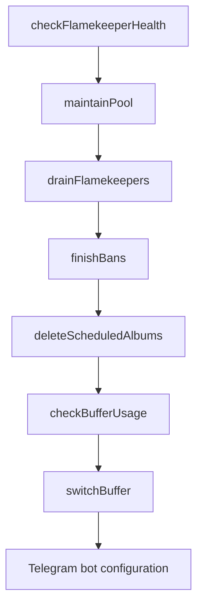
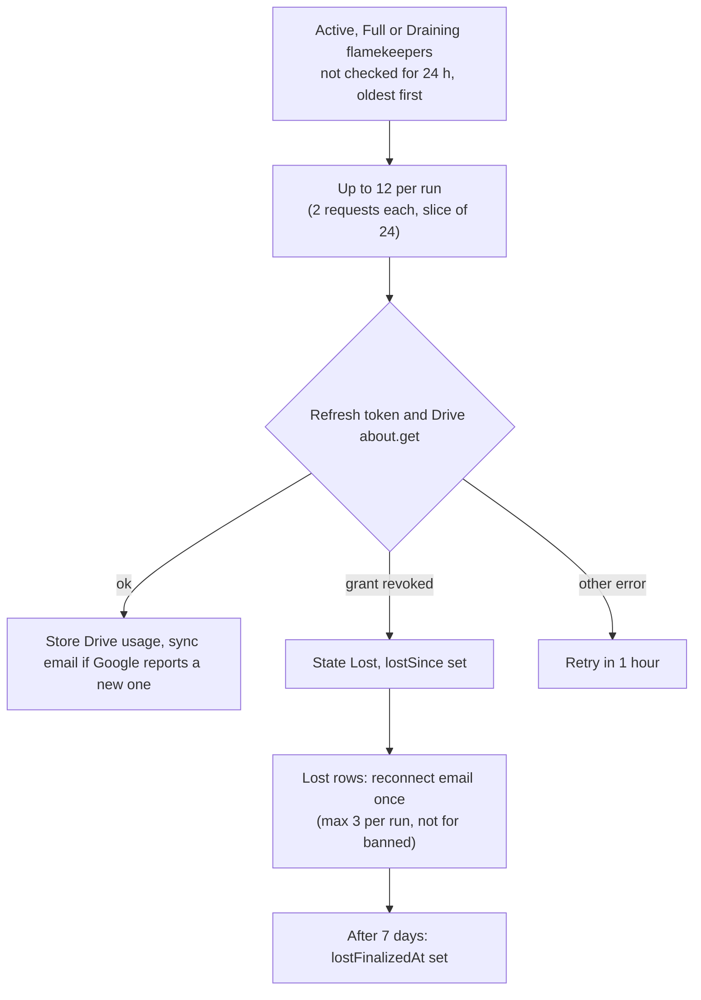
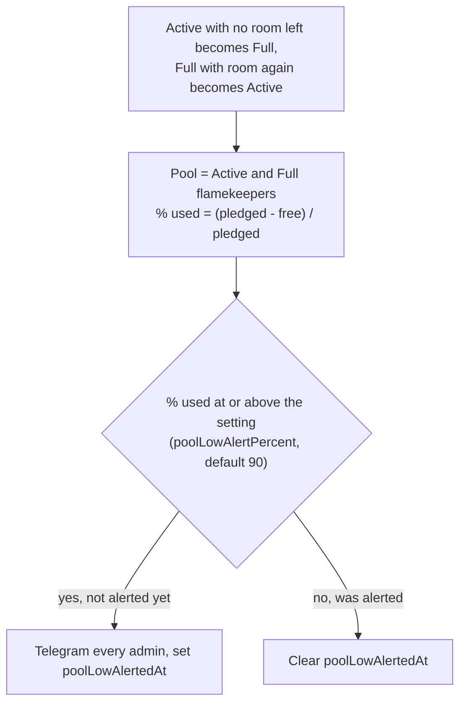
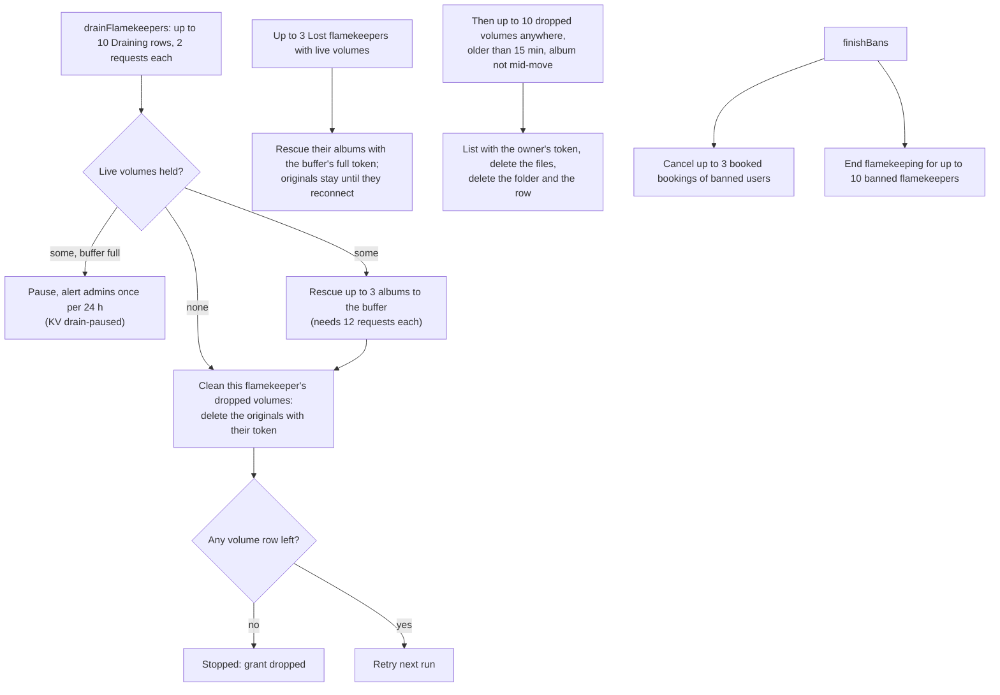
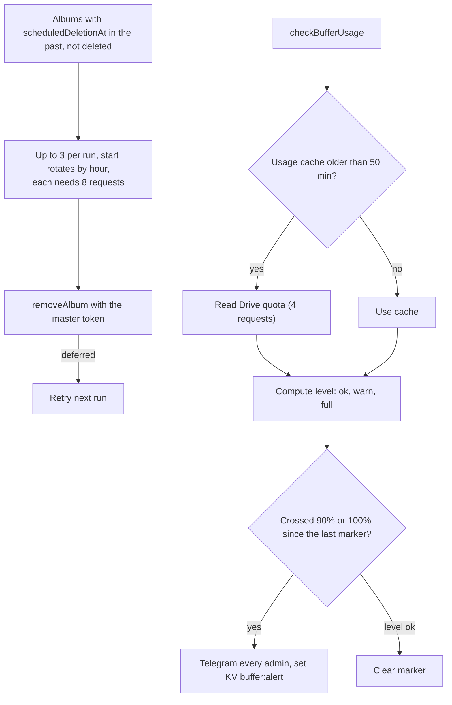

# Hourly

Schedule `0 * * * *`. Steps run in this order. Budget rules: [overview.md](overview.md). Flamekeeper states and the buffer: [GLOSSARY.md](../../../GLOSSARY.md).

What does the health check do?

What does the pool-low alert do?

How does a draining or banned flamekeeper end, and what happens to a lost one's photos?

Ending flamekeeping (`endFlamekeeping`) moves a flamekeeper to Draining while any volume row of theirs remains (live or dropped), otherwise to Stopped. Dropped volumes are rows whose files the app no longer lists: buffer originals after an offload, flamekeeper originals after a rescue, and partial copies of an abandoned move ([album-offload](../kv/album-offload.md)). A lost or stopped owner's dropped volumes wait until the owner can be reached again.

What do scheduled deletions and the buffer check do?

- Telegram bot configuration runs after the steps. It calls `setMyCommands` only when the deployed version differs from the KV marker [telegram-bot-version](../kv/telegram-bot-version.md).
- The lost grace period comes from the `lostGraceDays` setting (default 7) and the graduation stop lead from `graduationPromptDays` (default 60); the code constants are only the defaults.
- Related KV keys: [drain-paused](../kv/drain-paused.md), [buffer-usage](../kv/buffer-usage.md).
